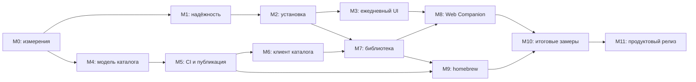
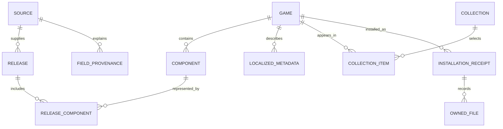

# pipensx: подробный роадмап до самостоятельного продукта

**Дата:** 30 сентября 2026. **База исследования:** локальный код
`21cb83da782c5dc79f806c144679c5e076359339`. Последний стабильный релиз на момент
проверки — [1.6.2](https://github.com/i3sey/pipensx/releases/tag/1.6.2).
Изменения в рабочем дереве и веб-макет не считаются выпущенными возможностями.

**Результат, к которому ведёт план:** пользователь устанавливает pipensx,
настраивает подходящий источник, находит игру или приложение, понимает состав
установки, отправляет очередь и получает проверяемый результат. После ошибки,
перезапуска, обновления приложения или временной недоступности каталога он может
продолжить работу без ручного разбора файлов и чтения длинных логов.

Это план реализации, а не отчёт о выполнении. Исходники приложения в рамках
подготовки документа не менялись; сборки и аппаратные испытания не запускались.
Численные цели ниже — **предлагаемые критерии**, исходные значения ещё нужно
измерить. Существование теста или защитного кода не доказывает отсутствие
ошибки на конкретной Switch.

## Навигация

1. [Образ готового продукта](#vision)
2. [Что уже есть и что ещё неизвестно](#baseline)
3. [Правила исполнения и приоритеты](#execution)
4. [Метрики качества и скорости](#metrics)
5. [Последовательность этапов](#sequence)
6. [M0 — измерения и воспроизводимость](#m0)
7. [M1 — надёжная загрузка и восстановление](#m1)
8. [M2 — понятная установка и хранение](#m2)
9. [M3 — удобный ежедневный интерфейс](#m3)
10. [M4 — собственная модель каталога](#m4)
11. [M5 — сборка и публикация через GitHub](#m5)
12. [M6 — быстрый клиент нового каталога](#m6)
13. [M7 — библиотека, версии и обновления](#m7)
14. [M8 — полноценный Web Companion](#m8)
15. [M9 — homebrew, порты и дополнения](#m9)
16. [M10 — производительность и энергопотребление](#m10)
17. [M11 — релизы, поддержка и завершение продукта](#m11)
18. [Что оставить после основной программы](#later)
19. [Архитектура самостоятельного каталога](#catalog-architecture)
20. [Матрица проверок](#verification)
21. [Очередь первых работ и планирование](#planning)
22. [Риски, эксплуатация и критерии завершения](#finish)
23. [Источники и границы исследования](#references)

<a id="vision"></a>

## 1. Образ готового продукта

### 1.1. Что значит «самодостаточный»

Самодостаточность здесь состоит из четырёх частей:

| Область        | Как выглядит готовое состояние                                                                                                                       |
| -------------- | ---------------------------------------------------------------------------------------------------------------------------------------------------- |
| Пользователь   | Основные действия выполняются на Switch или с телефона. Для обычной установки не нужны компьютер и инструкция из чата.                               |
| Данные         | У проекта собственные идентификаторы, схема каталога, правила слияния и публикации. Удаление одного внешнего источника не уничтожает всю библиотеку. |
| Инфраструктура | Сборка приложения и каталога работает на размещённых CI runners. Автору не нужно держать домашний компьютер или VPS включённым.                      |
| Поддержка      | Есть воспроизводимые релизы, диагностика, понятный откат, документация и процесс приёма исправлений. Продукт не держится на памяти одного человека.  |

Полная независимость от интернета, GitHub, владельцев исходных данных,
торрент-пиров и платных провайдеров недостижима. Нужны заменяемые каналы,
последнее исправное локальное состояние и честное объяснение отказов.
Публичный каталог метаданных также не создаёт доступ к файлам сам по себе:
источники загрузки и права на содержимое остаются отдельной частью системы.

### 1.2. Основные пользовательские обещания

1. **Найти:** одна карточка игры вместо множества непонятных релизов;
   поиск по названию, альтернативным названиям, студии и жанру.
2. **Выбрать:** перед установкой видны версия, язык, компоненты, место,
   назначение файлов и известные ограничения.
3. **Установить:** очередь понятна, действия доступны по текущему состоянию,
   прогресс отличает подготовку, скачивание, распаковку и commit.
4. **Продолжить:** пауза, пропажа сети и перезапуск не требуют начинать всё заново;
   непроверенные данные проверяются, завершённые пакеты учитываются отдельно.
5. **Поддерживать библиотеку:** обновления, DLC, homebrew и дополнительные файлы
   можно осмотреть, обновить и удалить без случайного удаления чужих данных.
6. **Понять проблему:** сообщение даёт причину, действие и короткий отчёт для
   поддержки. Не нужно угадывать, означает ли «0%» зависание или проверку.
7. **Пользоваться быстро:** поиск, прокрутка и переходы работают и во время
   загрузки, установки и обновления каталога.

### 1.3. Чего не включать в основной объём

- Сидирование, ratio и функции обмена после загрузки не входят в этот план.
- Облачный аккаунт, социальная сеть, чат и собственный сервер аналитики
  не нужны для основных сценариев.
- Фоновая установка во время игры и загрузка в настоящем sleep не обещаются.
  Это отдельные исследования с аппаратными ограничениями.
- Полный файловый менеджер, поддержка всех архивов и всех форматов пакетов
  не должны задерживать надёжность текущих форматов.
- Переписывание на другой язык или UI framework не является этапом.
  Сначала измерения, границы ответственности и локальные изменения.

<a id="baseline"></a>

## 2. Что уже есть и что ещё неизвестно

### 2.1. Использовать существующую основу

| Уже присутствует в коде                                             | Куда развивать                                                                                 | Основание                                                                                                        |
| ------------------------------------------------------------------- | ---------------------------------------------------------------------------------------------- | ---------------------------------------------------------------------------------------------------------------- |
| Постоянная очередь, pause/resume/retry/recheck, до четырёх загрузок | Единый пользовательский статус, управление порядком, бюджет места, восстановление по сценариям | [DownloadManager](../src/app/download_manager.hpp)                                                               |
| NSP/NSZ, последовательная установка, журнал и контрольные точки     | Проверка всех точек отказа, понятный итог, защита текущего состояния при обновлении            | [PackageStream](../src/install/package_stream.hpp), [журнал](../src/install/install_journal.hpp)                 |
| TorBox, Real-Debrid, AllDebrid и TorrServer                         | Диагностика, единые возможности, управление источником для конкретной задачи                   | [DebridProvider](../src/app/debrid_provider.hpp)                                                                 |
| Общий путь добавления через ReleaseAdder                            | Сохранить единое поведение Switch, Web и массовых действий                                     | [AddRelease](../src/app/add_release.hpp), [WebAddQueue](../src/app/web_add_queue.cpp)                            |
| Smart Install, выбор файлов, проверка места                         | Единый InstallPlan для всех сценариев и более точная оценка очереди                            | [InstallSpace](../src/app/install_space.hpp), [TaskFiles](../src/app/task_files.hpp)                             |
| Каталог, описания, скриншоты, избранное, multiplayer-фильтры        | Собственные game ID, несколько источников, языковые фильтры и группировка релизов              | [CatalogPresentation](../src/app/catalog_presentation.hpp)                                                       |
| Каталог строится в фоне, ready snapshots, поколения                 | Инкрементальный поиск, компактный индекс, транзакционное обновление нового формата             | [CatalogService](../src/app/catalog_service.hpp), [CatalogRefresh](../src/app/catalog_refresh.hpp)               |
| Приоритеты изображений, отдельные local/network workers, LRU        | Измерения, миниатюры, ограничение decode и GPU памяти                                          | [GameMetadataService](../src/app/game_metadata_service.hpp)                                                      |
| Бюджет текстур по кадру, байтам и времени                           | Аппаратные замеры и обработка одиночных больших изображений                                    | [ImageUploadBudget](../src/ui/common/image_upload_budget.hpp)                                                    |
| Библиотека установленного и проверка версий, массовые обновления    | Предпросмотр изменений, компоненты, выбор версии и исключения                                  | [GameUpdateService](../src/app/game_update_service.hpp), [InstalledView](../src/ui/installed/installed_view.hpp) |
| NRO, ZIP/7z, forwarders, deployment receipts, LayeredFS             | Полноценный менеджер приложений и проверяемое удаление                                         | [SwitchDeploy](../src/app/switch_deploy.hpp), [PortArchive](../src/app/port_archive.hpp)                         |
| Web Companion, PIN, SSE, каталог, очередь, настройки                | Библиотека, InstallPlan, паритет с консолью, устойчивость к reconnect                          | [WebServer](../src/app/web_server.hpp), [веб-клиент](../resources/web/app.js)                                    |
| QR-отчёты, диагностика, crash/ANR механизмы                         | Связь ошибки с конкретной сборкой и пользовательским сценарием                                 | [BugReport](../src/app/bug_report.hpp), [гайд фиксов](bugfix-guide-2026-09-28.md)                                |
| Автообновление NRO с SHA-256, staging и предыдущей версией          | Проверяемый откат, миграции и усиление доверия к релизам                                       | [UpdateService](../src/app/update_service.hpp)                                                                   |
| PC tests, ASan/UBSan, fuzz smoke, Switch build и gitleaks           | Сценарии отказов, браузерные контракты и аппаратные release gates                              | [CI](../.github/workflows/ci.yml)                                                                                |

Старый [план улучшений](improvement-roadmap.md) и
[аудит производительности](performance-audit-status.md) полезны как история,
но их статус необходимо сверять с исходниками. В частности, задачи «добавить
приоритеты изображений», «добавить LRU», «вынести построение каталога в фон»
и «добавить бюджет текстур по реальному кадру» уже нельзя ставить как новые.

### 2.2. Открытые сигналы поддержки

На дату исследования открыты следующие issues. Их наличие не доказывает,
что исходный дефект воспроизводится в текущем локальном коде.

| Issue                                                                                  | Работа в этом плане                                                                                       |
| -------------------------------------------------------------------------------------- | --------------------------------------------------------------------------------------------------------- |
| [#86 — падение при начале прямой загрузки](https://github.com/i3sey/pipensx/issues/86) | M0-02 и M1-01: точная версия, crash report, воспроизведение, аппаратное подтверждение защитных изменений. |
| [#87 — выбор torrent-файла](https://github.com/i3sey/pipensx/issues/87)                | M3-06: проверить исправление текущего picker на именах, регистрах и неподходящих файлах.                  |
| [#77 — Real-Debrid SSL](https://github.com/i3sey/pipensx/issues/77)                    | M1-06: различать DNS, сертификат, дату, handshake, proxy и ошибку провайдера.                             |
| [#76 — непонятная ошибка скачивания](https://github.com/i3sey/pipensx/issues/76)       | M1-05 и M3-01: получить точный сценарий; улучшение текста не выдавать за исправление неизвестной причины. |
| [#75 — TorrServer/Torrenting disabled](https://github.com/i3sey/pipensx/issues/75)     | M1-07 и M8-01: перепроверить актуальную версию и оба интерфейса; общий веб-путь уже есть.                 |
| [#72 — сброс прогресса после Power/pause](https://github.com/i3sey/pipensx/issues/72)  | M1-02: различать отображение прогресса, потерю данных и повторную проверку.                               |
| [#63 — обнаружение Real-Debrid](https://github.com/i3sey/pipensx/issues/63)            | M3-02: настройка и объяснение существующего провайдера.                                                   |

### 2.3. Неизвестное, которое нужно выяснить первым

- Причина оставшихся аппаратных падений и зависаний.
- Производительность на обычной Switch без разгона, с медленной SD и плохим Wi-Fi.
- Реальный размер метаданных, изображений, кэшей и p95 времени поиска.
- Какая доля релизов достоверно сопоставлена с игрой и компонентами.
- Какие источники дадут нужные поля, регулярные обновления и приемлемые условия
  повторной публикации без обязательной зависимости от каталога Langegen.
- Какие операции реально блокируют UI, а какие уже исправлены.
- Частота пользовательских запросов на XCI/XCZ, эмуляторы, локальную установку
  и другие дорогие расширения.

<a id="execution"></a>

## 3. Правила исполнения

### 3.1. Приоритет и размер задачи

| Метка | Значение                                                                                      |
| ----- | --------------------------------------------------------------------------------------------- |
| P0    | Падение, потеря состояния/данных, риск испортить установку; либо исследование такого сигнала. |
| P1    | Основной пользовательский сценарий нарушен, непонятен или слишком медленный.                  |
| P2    | Значительное улучшение удобства, самостоятельности или сопровождения.                         |
| P3    | Расширение после достижения основных критериев.                                               |
| S     | Изолированная работа в одном компоненте с понятной проверкой.                                 |
| M     | Несколько компонентов, данные или несколько пользовательских сценариев.                       |
| L     | Новая подсистема, миграция или существенная аппаратная проверка.                              |
| XL    | Несколько связанных задач; перед реализацией разделить на меньшие.                            |

Размеры относительные и не переводятся автоматически в календарные дни.
Приоритет описывает необходимость результата; этап описывает зависимости.
Высокоприоритетный клиент дельт не пишется до определения схемы и подписанного
manifest. Криптографические проверки не откладываются до момента, когда
пользователи уже получают непроверенные production-обновления.

### 3.2. Статусы работы

`Предложено → Исследование → Готово к реализации → Реализовано → Проверено на PC
→ Проверено на Switch → В beta → Выпущено`.

Для задач только по каталогу или вебу ненужный аппаратный статус заменяется
соответствующей проверкой клиента/браузера. «Реализовано» и «выпущено» — разные
статусы. У каждой задачи должна быть ссылка на commit/PR, результат проверки
и версия первого релиза, где она доступна.

### 3.3. Общий Definition of Done

1. Есть конкретный пользовательский сценарий до/после изменения.
2. Поведение при ошибке, отмене, повторном запуске и перезапуске определено.
3. Состояние, API и UI не расходятся; применимые команды берутся из общей модели.
4. Проверены совместимость данных и повторная миграция.
5. Прошли требуемые сборки/тесты, переводы и проверки источников сборки.
6. Для операций Switch записан аппаратный сценарий и его результат.
7. Изменение доступно из интерфейса, объяснено пользователю и отражено в документации.
8. Нет неограниченного роста кэша, фоновой работы, повторных запросов или логов.
9. Есть способ диагностировать и восстановить отказ без секретов в публичных отчётах.
10. Новая возможность не ухудшает основной сценарий выше утверждённых порогов.

### 3.4. Организация работы

- Вести задачи в GitHub Issues по [правилам репозитория](agents/issue-tracker.md).
  Этот документ — карта; он не заменяет маленькие tickets с проверяемым результатом.
- На одну основную ветку работы приходится один законченный сценарий, а не
  одновременные изменения движка, UI, формата состояния и каталога.
- Ограничить незавершённую работу: одна задача реализации и одно отдельное
  исследование. У нескольких разработчиков — отдельные области и явные зависимости.
- Каждые две недели пересматривать приоритеты по ошибкам и измерениям.
- Обязательные сложные решения записывать в ADR в `docs/adr/`, когда решение
  действительно принято: модель идентификаторов, доверие к manifest,
  транзакция публикации, миграции и владение homebrew-файлами.
- Сохранять C++17 для общего `src/core`/`src/app`; не выбирать C++20 API только
  потому, что Switch CMake его допускает.
- Перед будущими изменениями libnx/install/platform использовать skill `libnx`;
  перед изменением провайдера или версии persisted state — `debrid`.

<a id="metrics"></a>

## 4. Метрики качества и скорости

### 4.1. Предлагаемый стартовый scorecard

Значения согласовать после M0. Они нужны, чтобы понимать слово «быстрый»,
а не выдавать ненаблюдавшиеся результаты за факт.

| Метрика                                       | Предлагаемая цель                                                  | Как измерять                                                                          |
| --------------------------------------------- | ------------------------------------------------------------------ | ------------------------------------------------------------------------------------- |
| Первый интерактивный экран, тёплый старт      | p95 ≤ 2.5 с                                                        | 20 запусков с локальным кэшем, без обязательного сети/metadata wait.                  |
| Первый интерактивный экран, холодный старт    | p95 ≤ 5 с                                                          | Чистая конфигурация; каталог может загружаться позже.                                 |
| Отображение сетки из тёплого кэша             | p95 ≤ 300 мс после действия                                        | Не включает загрузку недостающих обложек.                                             |
| Поиск по проектному размеру каталога          | p95 ≤ 150 мс после короткого debounce                              | 1k, 10k и 30k синтетических записей; старые запросы отменяются.                       |
| Отклик на навигацию                           | p95 ≤ 100 мс                                                       | Кнопка/касание → видимое изменение; во время активной установки отдельно.             |
| Кадр каталога                                 | p95 ≤ 16.7 мс в обычном режиме                                     | Цель 60 FPS на reference setup; загрузка и docked отдельно.                           |
| Кадр при тяжёлой установке                    | p95 ≤ 33.3 мс, без регулярных пауз > 250 мс                        | Разрешённый режим 30 FPS, управление остаётся доступным.                              |
| Новая видимая обложка из disk thumbnail cache | p95 ≤ 250 мс                                                       | Разделить I/O, decode, очередь и texture upload.                                      |
| Пауза/отмена                                  | Сразу подтверждена; достижение безопасной точки обычно ≤ 3 с       | Commit может требовать завершения; объяснять ожидание, не обрывать его произвольно.   |
| Проверка manifest без изменений               | Один маленький запрос                                              | Обновление не скачивает весь каталог.                                                 |
| Качество инкрементального обновления          | Обычная дельта ≤ 10% полного снимка на fixture                     | При большом изменении выбрать полный снимок; измерять bytes, не только число записей. |
| Сетевые запросы неизменившейся карточки       | 0 повторных body downloads при валидном кэше                       | Request counters на возврате и переключении вкладок.                                  |
| Полезная скорость загрузки                    | Нет необъяснимого падения к нулю на стабильном локальном источнике | Сравнение одинаковых fixtures, условий сети, SD и режима установки.                   |
| Издержки UI при download-only                 | Целевой регрессионный порог ≤ 10% throughput                       | После baseline; не обещать абсолютную скорость публичного swarm.                      |
| Память в длительном сценарии                  | Нет устойчивого роста после прогрева                               | 30 установок/повторов, графики heap, image, piece и thread ресурсов.                  |
| Установка и восстановление                    | Все сценарии release matrix проходят                               | Kill/обрыв в каждой контролируемой фазе на тестовых пакетах.                          |
| Самостоятельное решение пользователя          | ≥ 90% основных заданий без внешней инструкции                      | Маленькая usability-сессия, фиксировать реальные затруднения.                         |
| Каталог и инфраструктура                      | Не требуют домашнего ПК для плановой сборки                        | Выполненная GitHub-hosted сборка и восстановление после её сбоя.                      |

### 4.2. Условия замеров

У каждого результата сохранять commit, версию ОС/CFW, модель консоли,
application/applet mode, наличие разгона, класс и свободное место SD,
Wi-Fi/USB Ethernet, источник и fixture. Не смешивать OLED и обычную Switch
в один показатель без раздельных результатов. Приложение сейчас требует
application mode; таблица не обещает поддержку запуска через Album.

Сеть: локальный HTTP/TorrServer для повторяемости, контролируемый torrent
fixture и отдельный публичный swarm как внешняя проверка. Сначала использовать
легально распространяемые тестовые данные. Среднее не заменяет p95,
а успешная маленькая установка не заменяет многочасовой сценарий.

Логи/метрики по умолчанию остаются локальными. Добровольный отчёт должен
показывать пользователю состав данных; скрытая отправка аналитики не нужна.

<a id="sequence"></a>

## 5. Последовательность этапов

| Этап | Выход                                                           | Главные зависимости                                                 |
| ---- | --------------------------------------------------------------- | ------------------------------------------------------------------- |
| M0   | Baseline, fixtures, регрессионные сценарии и критерии           | Нет.                                                                |
| M1   | Загрузка/пауза/восстановление без известных критических отказов | M0.                                                                 |
| M2   | Понятный и проверяемый InstallPlan, место, итоги и очистка      | M1, существующие installer/deploy сервисы.                          |
| M3   | Самостоятельный onboarding и удобные ежедневные экраны          | M1–M2; часть UI можно улучшать раньше.                              |
| M4   | Независимая схема, идентификаторы, первые источники             | M0; проектирование можно делать во время аппаратных проверок M1.    |
| M5   | Проверенная автоматическая публикация каталога                  | M4; инфраструктура доверия до публичного клиента.                   |
| M6   | Быстрый офлайн-клиент нового каталога                           | M4–M5; первые замеры из M0.                                         |
| M7   | Одна игра, все версии и управляемая библиотека                  | M2, M4, M6.                                                         |
| M8   | Паритет Web Companion и консоли                                 | M2–M3, M6–M7.                                                       |
| M9   | Управляемые homebrew/порты/дополнения                           | M2, M4–M5; библиотека M7.                                           |
| M10  | Подтверждённая скорость и разумное энергопотребление            | Baseline M0; оптимизации идут малыми порциями на предыдущих этапах. |
| M11  | Продуктовый релиз, откат, поддержка, документация               | Основные gates M1–M10.                                              |

Не нужно ждать окончания M9, чтобы исправить медленный поиск или выпускать
патчи M1. Релизы проходят после завершённых вертикальных сценариев.
Публикация первой версии нового каталога тоже может случиться до полной
библиотеки, если доверие, кэш и миграции уже проверены.



<a id="m0"></a>

## 6. M0 — измерения и воспроизводимость

**Цель:** до расширения продукта знать, какие сценарии медленны или ненадёжны,
и иметь способ доказать улучшение. **Gate:** повторяемые замеры и fixtures,
точная граница между исправленным кодом и аппаратно подтверждённым результатом.

### M0-01. Зафиксировать reference setups — P1 / S

Описать минимум одну Switch без разгона, одну повторяемую SD-конфигурацию,
Wi-Fi сеть и локальный источник тестовых данных. Дополнительные setups:
медленная SD, мало свободного места, USB Ethernet, docked и OLED.
Зафиксировать application mode, настройки источника и максимальную очередь.

**Готово:** любой следующий отчёт о скорости или ошибке содержит идентификатор
setup и позволяет повторить условия. Смена SD или версии не выдаётся за
доказательство причины улучшения.

### M0-02. Привести актуальные баги к сценариям — P0 / M

Для #86, зависаний и остальных сигналов получить version/commit, шаги,
источник, фазу, log/crash report и ожидаемый результат. Составить короткие
регрессионные карточки. Отдельно пометить «защита добавлена», «исходная причина
установлена», «воспроизведение больше не наблюдается» и «выпущено».

**Готово:** нет задачи «исправить краш» без измеримого сценария; неизвестная
причина не получает вымышленный статус «починено». Внешние данные, без которых
диагностика невозможна, явно перечислены.

### M0-03. Собрать fixtures для всех типов работы — P1 / M

Подготовить безопасные маленькие и большие metainfo, multi-file torrent,
NSP/NSZ-парсерные fixtures, ZIP/7z с разными layouts, частичные пакеты,
ошибочные заголовки и каталоги 1k/10k/30k. Большие объёмы генерировать,
не коммитить гигабайты в репозиторий. Аппаратные install fixtures согласовать
с возможностями тестовой консоли отдельно от PC backend.

**Готово:** каждая матрица отказов опирается на доступный fixture и не зависит
от случайной публичной раздачи, текущего числа пиров или большого чужого каталога.

### M0-04. Разделить измерения UI, сети и установки — P1 / M

Добавить ограниченные счётчики: время первого кадра, input latency, build/apply
snapshot, image read/decode/upload, длительность lock и save, полезные байты,
повторные байты, install gate, commit, память и число потоков. Метрики не должны
сами делать синхронный flush на каждом кадре или каждый peer event.

**Готово:** медленную обложку можно отнести к сети, decode или GPU;
падение download rate — к swarm, gate, disk либо ограничениям памяти.
Нормальный режим не производит неограниченный лог.

### M0-05. Утвердить regression budget — P1 / S

Снять минимум два стабильных baseline-прогона, затем принять численные цели
из раздела 4 либо изменить их с объяснением. Для каждой метрики установить
условия измерения и допустимое отклонение. CI проверяет повторяемые показатели,
а аппаратная производительность публикуется с setup, без случайного hard fail
по сетевой скорости живого swarm.

**Готово:** слово «быстрее» сопровождается before/after, а принимающий решение
видит цену улучшения по RAM, SD I/O, батарее и сложности.

### M0-06. Проверить карту выполненных работ — P2 / S

Сверить старые R01–R20, performance audit и bugfix guide с кодом и релизами.
Не переписывать исторические результаты как новые измерения. Для актуальной
карты использовать статусы из раздела 3.2 и ссылки на существующие реализации.

**Готово:** при выборе следующей задачи не предлагается заново реализовать
текущие priority queues изображений, LRU, ReleaseAdder и существующий recovery.

<a id="m1"></a>

## 7. M1 — надёжная загрузка и восстановление

**Цель:** скачивание предсказуемо работает долго и переживает отказ.
**Gate:** известные P0 локализованы; обязательная матрица recovery пройдена
на reference setup, а открытые внешние блокеры явно названы.

### M1-01. Закрыть подтверждённые падения и зависания — P0 / M–L

Использовать exception/ANR диагностику текущего кода, локализовать fault/lock
и проверить сценарии #86 и F2. Изменять размеры буферов или timeouts по
доказательствам, а не только по внешнему сходству симптомов. Повторить навигацию
во время torrent/debrid, установки, открытия Help/About и выхода.

**Готово:** есть установленные причины и исправления для воспроизводимых
дефектов; исходный сценарий и длительный регрессионный прогон проходят.
Если остаётся неподтверждённый репорт, он не скрывается за «все тесты зелёные».
**Зависимость:** M0-02–04.

### M1-02. Проверить recovery как пользовательский контракт — P0 / L

Для download-only, stream-install и port-install проверить pause/resume,
чистый выход, kill, power loss, пропажу Wi-Fi и перезапуск. Различать доверенную
resume bitfield после чистого завершения и необходимость hash scan после
нечистого. Отдельно проверить первую маленькую safe point и несколько
уже committed пакетов.

**Готово:** данные не считаются проверенными только по старому проценту;
committed пакеты не устанавливаются повторно; UI объясняет проверку и возможный
откат процента. Есть результат для каждой ячейки matrix, а не один resume test.
**Основа:** recovery account, install journal и текущие tests.

### M1-03. Проверить бюджет RAM для всех режимов — P0 / M

Проверить admission limits для DownloadOnly, StreamInstall, PortInstall,
параллельных задач, крупных piece и работы изображениям. Budget arbiter должен
ограничивать суммарный объём, а не только один torrent. Allocation failure
не превращается в «блок получен» и бесконечный тихий retry.

**Готово:** под нехваткой памяти снижается конкурентность/предзагрузка или
появляется диагностируемая ошибка. Отмена высвобождает ресурсы; график heap
после повторов возвращается к ожидаемому уровню. **Зависимость:** M0-03–04.

### M1-04. Проверить длительную скорость и install gate — P0 / M

Зафиксировать regression для уже исправленной EMA/gate деградации.
Смотреть useful throughput, inflight, frozen, cooldown, disk stalls и
head-piece starvation на часовых контролируемых прогонах. Использовать
ограниченный источник, быстрый источник и источник с временными провалами.

**Готово:** на стабильном источнике нет самоподдерживающегося падения скорости;
throttle снимается после дренирования буфера; лог указывает причину ограничений.
Не отключать backpressure ради красивого мгновенного показателя.

### M1-05. Ввести структурированные причины ошибок — P1 / M

У задачи хранить категорию, этап, retryability, короткий текст, технические
details и correlation ID. Отделить пользовательский отказ, сетевую ошибку,
ошибку metainfo, нехватку места, неподдерживаемый формат, install/deploy conflict
и отказ провайдера. Использовать единый перевод в Switch и Web.

**Готово:** Retry предлагается только там, где имеет смысл; ошибка «нет базы»
не превращается в бесконечное повторение HTTP-запроса. После retry пользователь
понимает, что сохраняется. **Зависимость:** договорённость о persisted schema;
миграция при изменении формата состояния.

### M1-06. Диагностика соединения и debrid — P1 / M

Отдельно диагностировать DNS, connect timeout, TLS handshake, certificate,
proxy, авторизацию, quota/rate limit и состояние transfer на провайдере.
Сделать короткую проверку endpoint и credentials без скачивания большого файла.
Time/date проблеме давать собственное объяснение; не предлагать глобально
отключить TLS-проверку. Retry использует bounded backoff и учитывает Retry-After.

**Готово:** сценарий #77 выдаёт диагностируемый класс отказа и следующее действие;
секреты не попадают в сообщение, URL, QR или публичный issue. Консоль и телефон
показывают один результат для одного источника.

### M1-07. Сохранить единый импорт и защиту от дублей — P1 / M

Проверить catalogue/magnet/torrent import, double click, повтор после reconnect,
batch и импорт уже частично установленного релиза. Все пути используют общую
логику выбора источника и capabilities. Изменение глобального провайдера не
должно незаметно менять уже выполняемую задачу.

**Готово:** повторные команды идемпотентны либо возвращают текущую задачу;
выбор файлов не теряется; новый импорт не активирует прямые torrent-соединения,
если пользователь выбрал серверный источник. **Основа:** ReleaseAdder.

### M1-08. Пауза, отмена, выход и reconnect — P1 / M

Определить допустимое поведение каждой фазы. На безопасной фазе остановить
работу; при commit показать «завершаем текущую операцию». Проверить callbacks
закрытых экранов и остановку worker threads. Обрыв клиента Web не означает
отмену задачи на консоли.

**Готово:** нет deadlock на shutdown, двойного удаления, callback к уничтоженному
View и зависшей задачи после закрытия диалога. Восстановление сети не создаёт
вторую копию transfer. **Зависимость:** M1-02, M1-05.

<a id="m2"></a>

## 8. M2 — понятная установка и хранение

**Цель:** до старта понятно, что произойдёт, после завершения — что произошло.
**Gate:** операции установки, очистки и удаления имеют общую проверяемую модель
и корректно работают при частичном отказе.

### M2-01. Общий InstallPlan поверх существующих механизмов — P1 / L

Собрать план из выбора пользователя, установленного состояния и фактического
состава релиза. Для каждого файла/компонента: download/install/skip, причина,
версия, целевой storage/path, зависимости, размер и точность оценки. План
готовится в фоне; массовые действия используют тот же механизм.

**Готово:** карточка, chooser, batch и Web показывают один план. Перед исполнением
проверяются изменения свободного места/установленности; устаревший план
пересчитывается. Не переписывать рабочие installer/deploy backend ради абстракции.
**Основа:** InstallSpace, TaskFiles, GameUpdateInstall, SwitchDeployPlan.

### M2-02. Зависимости base/patch/DLC и downgrade — P1 / M

Проверить выбор patch без установленной базы, DLC без parent game,
несовпадающие title ID и версии. Base-before-update — порядок, но не гарантия
полноты. При непроверенной связи показать неизвестность; при потенциальном
downgrade объяснить замену и применимый безопасный путь.

**Готово:** пользователь не получает «успех» для заведомо неполного сценария
без предупреждения. Выбор версии учитывает состав фактических пакетов, а не
только имя раздачи. **Зависимость:** M2-01; полная группировка позже M7.

### M2-03. Бюджет места всей очереди — P1 / M

Отдельно считать скачиваемые байты, распакованный объём, временный scratch,
копирование/move и освобождение данных после установки. SD и NAND учитывать
раздельно. Reserved bytes незавершённых задач пересчитываются при выборе
файлов, отмене, завершении и смене target.

**Готово:** две допустимые по отдельности задачи не обещают совместную установку,
если места не хватает. Unknown NSZ expansion не выдаётся за точный результат;
оценка помечена Conservative/Unknown. Фильтр «поместится» остаётся предварительным.
**Основа:** существующий InstallSpaceEstimate.

### M2-04. Единый результат установки — P1 / M

Сохранять InstallResult: committed пакеты, версии, skipped с причинами,
deployed пути, частичные ошибки, временные данные и доступная очистка.
Показывать «база установлена, DLC не удалось», если результат частичный.
Download complete и install complete — разные события.

**Готово:** результат доступен после закрытия экрана и перезапуска. Повторное
действие работает только с оставшейся частью, а библиотека сверяется с консолью.
Ошибки записи результата не скрывают реальный commit. **Зависимость:** M1-02,
M2-01; формат receipts используется, где уже подходит.

### M2-05. Очистка истории, файлов и установленного — P1 / M

Развести действия: убрать запись из Downloads, удалить скачанные данные,
очистить кэш, удалить приложение, удалить его deployment. Перед удалением
показать объём и объекты; активные/locked данные не трогать. Длинный обход
и удаление выполнять вне UI-потока, сохраняя возможность навигации.

**Готово:** «очистить завершённые» не удаляет установленную игру; отмена очистки
не повреждает задачу; частичный отказ показывает фактический результат.
Проверить Settings, Downloads и Web, не добавлять существующее действие заново.

### M2-06. Неизвестные и дополнительные файлы — P1 / M

Для ZIP/7z/readme/переводов/LayeredFS объяснять «сохранить», «установить» и
«пропустить». Перед deploy показывать layout, target paths, конфликты,
состояние чужих файлов и ресурсную оценку. Не определять тип по расширению
без header/layout probe.

**Готово:** пользователь видит, что архив не равен NSP; no-layout означает
неподдерживаемую структуру, а не обязательно повреждённый архив. Установленные
дополнения можно найти в результате и библиотеке. **Основа:** PortArchive,
SwitchDeployInspection; дальнейшее развитие M9.

### M2-07. Миграции состояния и crash consistency — P0 / M

Для каждого нового persisted поля определить версию, default, валидаторы,
резервную копию и повторяемость миграции. Выдержать обрыв между записью temp,
flush/fsync, rename, commit пакета и записью результата. Проверить неизвестную
новую schema и ошибочный файл состояния.

**Готово:** старая очередь не исчезает при обновлении; неподдерживаемая schema
не перезаписывается пустым состоянием. Предыдущий NRO не запускается с
несовместимо мигрированной очередью без защитного сценария. **Зависимость:**
все M1/M2 задачи, которые вводят persistent поля.

<a id="m3"></a>

## 9. M3 — удобный ежедневный интерфейс

**Цель:** новым пользователям не нужен чат, а опытным не мешают настройки.
**Gate:** основные задания из usability checklist выполняются без подсказок,
touch/controller дают одинаковый результат.

### M3-01. Общие состояния и команды UI — P1 / M

Использовать TaskActions/capabilities как источник доступности кнопок.
В списке и details показывать Preparing, Fetching, Downloading, Installing,
Committing, Checking и итог с правильным знаменателем прогресса. Отдельно
показывать скорость download и install. Не показывать «нет пиров» для debrid.

**Готово:** одно состояние не называется тремя разными словами в Switch и Web;
disabled команда объясняет причину. Проверить уже сделанные R02/R03 по текущему
родительскому refresh и API, а не только по ячейке.

### M3-02. First-run и диагностика без терминологии — P1 / M

Сначала выбор реального способа загрузки: прямо с консоли, домашний сервер,
подключённый облачный провайдер. Затем минимальная настройка и проверка.
Объяснить источник метаданных, источник файлов и расходы на внешний сервис.
Не создавать впечатление, что приложение требует TorBox или что HTTPS proxy
проксирует peer traffic.

**Готово:** чистый старт достигает рабочего каталога и тестового добавления;
можно пропустить настройку и вернуться. Ключи настраиваются с телефона,
доступные провайдеры видны, миграция старых настроек не отключает загрузки.

### M3-03. Быстрый поиск и управляемые фильтры — P1 / M

До новой модели каталога добавить поиск по developer/publisher в существующих
полях, видимый запрос, сброс, count и сохранение фильтров в пределах сессии.
Затем alternative titles и языковые фильтры из M4/M6. Для контроллера: быстрый
вызов клавиатуры, переход A–Z, сохранение фокуса при возврате.

**Готово:** поиск по студии находит известную игру; новый результат не сбрасывает
фокус на начало при обычном обновлении task badge. Пустая выдача объясняет,
какие фильтры действуют. **Основа:** CatalogPresentation/CatalogView.

### M3-04. Очередь как управляемый процесс — P1 / M

Добавить явный порядок, перемещение задачи, приоритет «следующая», pause all,
resume all, clear completed и retry selected там, где применимо.
Сразу показывать, меняет ли перестановка активную задачу или только следующие.
Оценку времени выводить диапазоном/неизвестно, если источник нестабилен.

**Готово:** порядок сохраняется после перезапуска; batch не обгоняет вручную
выбранную следующую задачу без объяснения; сериализованная установка не
превращается в несколько concurrent commit. **Зависимость:** M1-07, M2-03.

### M3-05. Домашний экран с полезными разделами — P2 / M

На основе макета: продолжить незавершённое, обновления библиотеки, небольшие
игры, подборки и recently installed. Home уже существует и выключен по
умолчанию; сначала проверить его нагрузку и ценность, потом менять default.
Сделать компактный режим без hero и режим со сниженной анимацией.

**Готово:** главный экран помогает выполнить действие за меньше шагов;
нет обязательного скачивания больших баннеров для начала работы.
Подборка с неизвестным языком не обещает поддержку языка по художественному тексту.

### M3-06. Навигация, доступность, переводы — P1 / M

Проверить D-pad, sticks, touch, docked, handheld, длинные строки, locale fallback,
контраст, масштабы шрифта и цветовые статусы с текстом/иконкой. Нужны
предсказуемый Back, возврат фокуса и выключаемые необязательные анимации.
Проверить picker #87 на .TORRENT, Unicode, скрытых и неподходящих файлах.

**Готово:** каждое основное действие доступно без touch; длинный перевод не
скрывает единственную кнопку. Новые locale keys добавлены сначала в en-US
и проходят `scripts/check_i18n.py` для всех поддерживаемых языков.

### M3-07. Журнал событий и короткий отчёт — P2 / M

Показать недавние завершения, ошибки, смены источника, recovery и очистки.
В записи — время, задача, этап, итог и действие. Retention и размер ограничены.
Отчёт объединяет версию, correlation ID и выбранные диагностические данные,
а не всю историю пользователя.

**Готово:** пользователь может найти вчерашнюю ошибку после перезапуска,
не расшифровывая runtime log; QR-report остаётся компактным и совместимым
с декодером. **Зависимость:** M1-05, M2-04.

<a id="m4"></a>

## 10. M4 — собственная модель каталога

**Цель:** владеть устройством базы и пользовательским опытом, а не только URL
чужого JSON. **Gate:** одна и та же схема собирается минимум из двух независимых
типов входных данных; выключение необязательного адаптера Langegen не ломает
карточки, ID и собственные редакционные записи.

### M4-01. Утвердить сущности и идентификаторы — P1 / L

Разделить Game, Component, Release, Source, Collection и InstallationReceipt.
Game — произведение на конкретной платформе; Component — base/patch/DLC либо
homebrew application/data; Release — определённый набор файлов одного источника.
Hash торрента и название не становятся универсальным game ID.

Использовать стабильный namespace: аппаратный базовый title ID, когда связь
достоверна, либо собственный неизменяемый ID с aliases. NRO и эмуляторы
не обязаны иметь Nintendo title ID. Нельзя автоматически объединять все
похожие имена, региональные варианты и forwarder ID.

**Готово:** описаны правила game identity, компоненты и переход с infoHash
избранного; есть fixtures ремастера, ремейка, region variants, patch, DLC,
порта и раздачи с несколькими играми. **Зависимость:** M0-03, M2-01.

### M4-02. Schema v1 и контракт совместимости — P1 / M

Определить обязательные/опциональные поля, unknown, ограничения длины,
количества screenshot URL, языков и компонентов. Развести display version,
machine-comparable version, размер download и installed footprint.
Ввести schema_version, min_client_version и explicit feature capabilities.

**Готово:** валидатор принимает fixture и отвергает неоднозначные типы,
неверные ID, отрицательные/переполненные размеры и лишние опасные поля.
Старый клиент способен отказаться от неподдерживаемой схемы без потери кэша.
Пример в README макета уточняется до рабочей спецификации.

### M4-03. Реестр источников и допустимые поля — P1 / M

Для источника записать owner, endpoint, тип, формат, нужную авторизацию,
лимиты, условия повторного использования, поля и fallback.
Приоритет: официальные homebrew-релизы, собственные редакционные карточки,
добровольные исправления и открытые структурированные метаданные.

Отдельно исследовать источники разрешённых к распространению релизов:
official feeds, авторские публикации и другие подходящие индексы. Импорт
исходных release records должен быть собственным adapter, а не обязательным
скачиванием готового JSON конкурента. Зафиксировать, какой corpus содержит
только карточки, а какой даёт реально доступные пакеты.

[Wikidata](https://www.wikidata.org/wiki/Wikidata%3ALicensing) допускает CC0
для основных структурированных данных; это кандидат для названий, aliases
и связей, но не готовая база Switch-версий и совместимости. Права на картинку
не выводятся из наличия URL в Wikidata. Кандидаты должны пройти spike на
полноту, свежесть, доступность и полезность полей.

**Готово:** на каждый используемый источник есть SourceProfile;
каталог не обещает покрытие, которое фактически не измерено. Приватный API token
используется только в CI и не встраивается в публичный клиент.

### M4-04. Provenance, confidence и разрешение конфликтов — P1 / M

Для важных полей сохранять source ID, retrieved_at, исходное значение,
способ преобразования и confidence. Определить precedence на уровне поля,
а не «последний JSON победил». Локальная редакционная поправка может иметь
обоснованный приоритет, но должна быть проверяемой и отзываться при ошибке.

**Готово:** две конфликтующие версии или языковые метки не исчезают молча.
Карточка показывает источник важных сведений по запросу. Недоступность
источника делает его данные stale, а не удаляет заполненные поля.
**Зависимость:** M4-01–03.

### M4-05. Нормализация языков, жанров и поиска — P1 / M

Хранить язык текста и voice отдельно; распознавать ISO-коды и известные
варианты названий через таблицы с tests. Жанры приводить к небольшому
контролируемому словарю, сохраняя исходную запись. Для поиска подготовить
Unicode-aware folded названия, aliases, developer/publisher и языковые формы.

**Готово:** MULTI не автоматически означает русский; неизвестное не скрывается
под «English only». Ошибочные transliteration/normalization не объединяют
разные игры. Полнота языковых данных измеряется на sample, а не заявляется
по наличию translator UI.

### M4-06. Дедупликация релизов и связи компонентов — P1 / L

Объединять identical release по проверенному content identity; группировать
несколько релизов игры отдельно от дедупликации. Для torrent использовать
infoHash, для author asset — stable release/asset identity и digest, если
доступен. Общая игра не означает общий состав пакетов.

**Готово:** дубли из источников представлены одним релизом с несколькими
origins; неполные/непроверенные составы остаются различимы. CI обнаруживает
потерянные parent links. Доступность в debrid не переносится на другой hash.
**Зависимость:** M4-01, M4-04, M2-02.

### M4-07. Редакционные подборки и community workflow — P2 / M

Хранить подборки ссылками на game ID и критериями: размер, подтверждённый
язык, одиночный/локальный multiplayer, длительность с происхождением данных,
настроение. Для ручной редакции нужны review и простой JSON/YAML template.
Начать с 5–10 небольших качественных подборок вместо обещания идеального топа
всех игр. Автоматические подборки отмечать как автоматические.

**Готово:** неизвестные ID и пустые подборки ловятся CI; изменение источника
релиза не уничтожает подборку. Пользователь может понять принцип отбора,
а maintainer исправить ошибку без пересборки приложения.

### M4-08. Каталог метаданных отдельно от личных файлов — P1 / M

Публичный snapshot содержит разрешённые к публикации сведения, ссылки на
допустимые релизы и official homebrew references. Личные magnet/доступы/закрытые JSON
подключаются на клиенте и связываются с game IDs. Не копировать автоматически
весь чужой каталог в свой репозиторий ради «независимости».

**Готово:** pipensx Community отображает собственные карточки без чужого feed;
личный источник добавляет доступные пользователю релизы. При отсутствии
источника файлов UI честно показывает «релиз не подключён», а не нерабочую
кнопку Install. **Зависимость:** M4-03–06.

<a id="m5"></a>

## 11. M5 — сборка и публикация через GitHub

**Цель:** регулярный каталог не зависит от мощности и uptime домашнего ПК.
**Gate:** сборка, проверка, подпись и публикация выполняются на hosted CI;
сбой источника/сборки не заменяет работающий каталог пустым или повреждённым.

### M5-01. Отдельный репозиторий каталога — P1 / M

Создать `pipensx-catalog` с schema, adapters, curated corrections, fixtures,
collections, scripts и workflows. Не смешивать частые data updates с C++
историей приложения. Generated крупные snapshots не коммитить при каждом
обновлении в main; publish outputs хранить в предназначенном для этого канале.

**Готово:** локальная сборка и CI принимают одинаковые inputs;
изменение адаптера reviewable. Репозиторий можно клонировать и получить
fixtures без многогигабайтной истории. Создание внешнего репозитория — отдельная
реальная задача, этот документ его не создаёт.

### M5-02. Адаптеры с инкрементальным импортом — P1 / L

Начать с авторских GitHub Releases и выбранного открытого metadata/curated
источника. Каждый адаптер имеет pagination, timeouts, ETag/Last-Modified,
bounded concurrency, retries, ограничения размера и исходный cache.
Архивы и executable code источника не запускать в сборке.

**Готово:** 304 не вызывает полную обработку без необходимости; 429/timeout
оставляет последний успешный результат, новый malformed JSON его не затирает.
Fixture-тесты адаптера не зависят от live API.
**Кандидат:** [публичный API Homebrew App Store](https://hb-app.store/api-info)
с `repo.json`; отдельно проверить условия каждого metadata/asset источника.

### M5-03. Детерминированная сборка и отчёт о качестве — P1 / M

Отсортировать выход, зафиксировать normalization rules и IDs, исключить
несодержательные timestamp changes из semantic diff. Отчёт: added/updated/
removed, conflicts, unknown language/version, unmatched releases, sources stale,
сжатый размер и длительность стадий. Времена получения хранить отдельно от
изменения содержимого записи.

**Готово:** одинаковые inputs дают одинаковые content hashes;
пустое semantic update не создаёт новый гигантский snapshot.
PR показывает изменения данных понятным summary. **Зависимость:** M4 schema.

### M5-04. Проверки, которые блокируют плохую публикацию — P0 / M

Проверять schema, уникальность IDs, связи, размер, лимиты строк/массивов,
источники, provenance и согласованность индекса. Настроить пороги неожиданного
удаления/роста/конфликтов относительно последнего снимка. Известное массовое
изменение требует явного reviewable override, а не ослабления проверки навсегда.

**Готово:** неверный адаптер, вернувший 0 записей, не очищает каталог;
изменение 42% записей из демо подтверждается fixture-проверкой в настоящем CI.
Команда publish не запускается после failed/partial validation.

### M5-05. Manifest, подпись и ключи доверия — P0 / L

Manifest описывает schema, catalog version, generated_at, min_client,
immutable URLs, compressed/uncompressed lengths и digests каждого файла.
Подписывать однозначные байты с проверенной portable библиотекой; не писать
свою криптографию. Проверку совместимости библиотеки с PC/Switch сделать до
окончательного выбора формата.

Определить root/public keys, key ID, rotation, revocation и поведение при
replay/rollback. SHA-256 выявляет изменение файла, но hash рядом с файлом
сам по себе не устанавливает происхождение. Ключ публикации хранить как
protected secret, не предоставлять PR code и не выводить в logs.

**Готово:** altered manifest, unknown key, altered chunk и replay ниже принятой
версии проверяются fixtures. Поддерживаемый откат имеет отдельное явно
авторизованное правило. Production-подписывающий workflow отделён от PR checks.

### M5-06. Публикация снимков и дельт — P1 / L

Публиковать outputs по version/content-addressed immutable пути. Сначала все
файлы и подпись, затем mutable pointer latest. Delta включает base/target,
изменённые объекты и tombstones. Перед публикацией воспроизвести delta на
базе и сверить полученный content root с полным snapshot.

**Готово:** обрыв в любом шаге не создаёт «успешный latest» с отсутствующими
файлами. Несовпадающая базовая версия приводит к full fallback. Большая delta
может заменяться full snapshot по byte threshold. **Зависимость:** M5-04–05.

### M5-07. Расписание, ручной запуск и наблюдаемость — P1 / M

Стартовая гипотеза: incremental раз в 6 часов в минуту, отличную от нуля;
полный reconciliation раз в неделю; ручной `workflow_dispatch`.
Для publishing использовать один concurrency group, ограниченный timeout
и достаточную history. Отчёт показывает last-success и возраст источников.

GitHub может задержать/пропустить scheduled job; в публичном репозитории
workflow может отключиться после 60 дней без активности.
Это [ограничения расписания](https://docs.github.com/en/actions/reference/workflows-and-actions/events-that-trigger-workflows),
а не обещание SLA каждые шесть часов.

**Готово:** maintainer видит пропущенное обновление и умеет восстановить
его вручную; клиент продолжает использовать last-good. Не поддерживать
бессмысленные коммиты только ради имитации активности.

### M5-08. Бюджет инфраструктуры и retention — P1 / M

Выбрать Pages для маленького bootstrap/manifest и ограниченного набора данных,
Releases для версионированных snapshots/deltas. Не использовать Actions artifacts
как постоянный пользовательский endpoint. Хранить ограниченное число полных
снимков и поддержку дельт на оговорённое окно.

[Standard hosted runners](https://docs.github.com/en/billing/concepts/product-billing/github-actions)
для публичных репозиториев бесплатны; это не отменяет отдельные квоты storage,
API и сайта. [Pages](https://docs.github.com/en/pages/getting-started-with-github-pages/github-pages-limits)
ограничивает опубликованный сайт 1 ГБ и имеет мягкий bandwidth limit
100 ГБ/месяц. [Release asset](https://docs.github.com/en/repositories/releasing-projects-on-github/about-releases)
должен быть меньше 2 GiB; не строить огромный monolithic asset без необходимости.

**Готово:** measured build minutes, storage, количество API requests,
monthly delivery estimate и процедура cleanup. При росте нагрузки есть
условия перехода на зеркало/CDN, а не обещание «GitHub бесконечный».

### M5-09. Минимальные права и восстановление публикации — P0 / M

PR checks read-only; publishing только из доверенной ветки; actions pinned
по SHA; untrusted input не подставляется в shell. Разделить право писать
релизы, право подписывать и data review. Нужны backup key procedure,
контроль доступа и документированный emergency stop.

**Готово:** испорченный/скомпрометированный адаптер не получает signing secrets;
последний verified snapshot можно восстановить на новом endpoint.
Планировать смену hosting без смены game ID и массовой потери избранного.
**Зависимость:** M5-05–08.

<a id="m6"></a>

## 12. M6 — быстрый клиент нового каталога

**Цель:** большой каталог открывается быстро, работает офлайн и обновляется
без пауз и повторной полной загрузки. **Gate:** аппаратные показатели M0,
новая схема, last-good, миграции и доверие к manifest проверены.

### M6-01. Компактный индекс и карточки по запросу — P1 / L

В bootstrap index оставить game ID, display title/aliases для нужного языка,
search keys, компактные filter fields, доступные компоненты и маленькую
cover reference. Descriptions, full screenshots, подробные release records
и provenance загружать по shard/карточке по требованию.

**Готово:** первый экран не парсит все длинные описания и массивы screenshot;
переключение языка не скачивает ненужные языки. Есть byte/RAM budget и замеры
на fixture 30k. Выбор JSON.zst/binary делается по замерам и отладке,
а не из предпочтения «всё бинарное всегда быстрее».

### M6-02. Last-good cache и атомарное применение — P0 / L

Скачать в staging, проверить подпись, размеры, digests, schema и связи.
Построить ready snapshot в фоне, затем заменить опубликованную версию и
состояние disk cache. Определить порядок fsync/rename и восстановление
interrupted adoption. Старое поколение остаётся доступным до завершения.

**Готово:** kill на download/validate/build/publish не даёт частичного каталога;
две связанные части index/locale не относятся к разным версиям.
Офлайн-перезапуск показывает последний целый снимок.
**Основа:** immutable snapshots и существующий refresh gate.

### M6-03. Conditional fetch и дельты — P1 / M

Проверять маленький manifest, использовать HTTP cache validators, скачивать
недостающие content-addressed chunks и совместимые дельты. Последовательность
дельт ограничить по числу/байтам; при старом кэше перейти к full.
При неуспешной дельте не менять текущий снимок.

**Готово:** день без изменений не приводит к full download; delta replay
даёт точно тот же root digest, что full snapshot. Недоступность старой версии
не превращается в бесконечный цикл retries. **Зависимость:** M5-06, M6-02.

### M6-04. Поиск без повторного полного преобразования — P1 / M

Подготовить индекс названий/aliases/developer/publisher и filter bitsets
на стадии загрузки snapshot. Объединять запросы по поколениям, отменять
устаревшие результаты, поддерживать debounce. Начать с простой измеряемой
модели; fuzzy search добавлять только после качественного exact/prefix.

**Готово:** p95 поиска укладывается в budget; запрос «A → AB → ABC» никогда
не заканчивается выдачей от «A». Normalization выполняется один раз на запись,
а не заново на каждый символ. **Основа:** CatalogBrowseGenerationQueue.

### M6-05. Кэш обложек и миниатюр — P1 / M

Использовать разрешённые artwork assets; для сетки — заранее подготовленный
thumbnail или безопасное локальное уменьшение и disk thumbnail cache.
Ключ учитывает content identity и size class. Сохранять byte/network/decode
budgets и существующий приоритет Current/Visible/Prefetch.

**Готово:** возврат к сетке не скачивает и не декодирует полный artwork заново;
быстрая прокрутка не грузит скрытые запросы бесконечно. Ошибочная JPEG/PNG
не приводит к неограниченному decode allocation. Public screenshots макета
не считаются готовыми разрешёнными production assets.

### M6-06. Миграция избранного и старых источников — P1 / M

Перенести infoHash favourites к game/release identity только при достоверной
связи. Неопределённые старые записи сохранить как legacy release, показать
возможность перепривязки. Поддержать старый custom JSON через versioned adapter
и понятную диагностику, не через вечные ветки в основном parser.

**Готово:** пользователь не теряет избранное, очередь и source URL;
новая база не создаёт ложные связи по похожему имени. Миграция повторяема,
есть экспорт/резервная копия и план возврата. **Зависимость:** M2-07, M4-01.

### M6-07. Несколько источников и локальный импорт — P1 / L

Дать SourceRegistry: official community metadata, homebrew, personal HTTPS
и local file. Каждому — отдельный кэш, версия и статус. Объединение выполняется
в фоне; отключение источника не отменяет уже committed installation.
Не хранить личные credentials в общедоступном URL каталога.

**Готово:** выключение чужого feed оставляет самостоятельный community каталог;
локальный файл работает без сети. Конфликт источников можно осмотреть,
а выбранный релиз хранит original source identity. **Зависимость:** M4-04/08.

### M6-08. Свежесть и доступность как разные показатели — P1 / M

Показывать возраст metadata snapshot, дату обновления исходного поля,
последнюю локальную проверку release и состояние провайдера отдельно.
Устаревший каталог может оставаться полезным; свежий snapshot не гарантирует
живые peers. Wall-clock ошибки не приводят к перепроверке каждые секунды.

**Готово:** «проверено CI» не называется «можно скачать»; network failure
не показывается как «обновлений нет». Можно работать с last-good и явно
запустить refresh. **Зависимость:** M1-05, M4-04, M5-07.

<a id="m7"></a>

## 13. M7 — библиотека, версии и обновления

**Цель:** пользователь управляет играми, а не только записями загрузок.
**Gate:** состояние библиотеки сверяется с консолью и остаётся понятным после
ручной установки, удаления и смены каталога.

### M7-01. Одна карточка игры, несколько релизов — P1 / L

Открывать Game detail: installed components, доступные релизы, версия,
языки, размеры, формат, происхождение и состояние проверки. Для неизвестной
идентичности оставить release detail, не скрывая его ошибочной группировкой.
Предусмотреть релиз с несколькими играми и game с несколькими регионами.

**Готово:** пользователь сначала выбирает игру, затем подходящий состав;
есть просмотр всех вариантов. Причина рекомендуемого релиза объяснима:
совместимость, нужный язык, полнота и проверенные версии, а не самая новая
дата названия. **Зависимость:** M4-01/06, M6, M2-01.

### M7-02. Компоненты библиотеки и сверка установок — P1 / M

Модель содержит базу, patch, DLC, homebrew/deployment и источник последнего
действия. Фактический установленный контент получать из InstalledTitleService
и проверяемых receipts; неизвестные ручные установки не объявлять отсутствующими
лишь из-за отсутствия истории pipensx.

**Готово:** после внешнего удаления/обновления библиотека корректируется;
данные uninstall не остаются навечно «установлены». Сканирование выполняется
в фоне и по подходящим событиям, а не обходится полностью на каждом tick.

### M7-03. Сравнение версий и предварительный результат обновления — P1 / M

Использовать structured package version, если она достоверно известна;
для display_version сохранять unknown/comparison error. Перед обновлением
показать current → candidate, какие компоненты изменятся, размер и target.
Если индекс неполон, статус SourceUnknown не заменять «всё актуально».

**Готово:** найденное обновление не выбирает случайную чужую региональную
раздачу. Проверка после установки использует реальную installed version,
а не только факт task completed. **Основа:** GameUpdateService.

### M7-04. Update all как план, а не слепая команда — P1 / M

Показать список кандидатов, исключения, общую оценку места и источник каждого
release. Пользователь снимает ненужные components и подтверждает план.
Повторная команда объединяется с текущими задачами; частичные отказы не
удаляют успешные результаты.

**Готово:** existing Update-all сохраняется и получает предпросмотр;
повторный click не создаёт дубликатов. Недостаток места показывает, какие
задачи можно отложить. **Зависимость:** M1-07, M2-03, M7-03.

### M7-05. Игнорирование и закрепление версии — P2 / M

Развести «не показывать конкретный candidate», «не проверять игру» и
«закрепить установленную версию». У исключения хранить основание, дату
и точный scope. Когда появляется другой новый candidate, пользователь
видит его согласно выбранной политике.

**Готово:** существующий ignored title не мешает обновлению остальных;
исключение можно снять на Switch и Web. Неизвестный version comparison не
позволяет автоматически выполнять downgrade. **Зависимость:** M7-03.

### M7-06. История, recently installed и избранное по игре — P2 / M

Сохранить недавние результаты, происхождение и выбор релиза. Избранное по
Game не исчезает после обновления hash; при желании можно сохранить конкретный
Release отдельно. История installation хранит ограниченный summary,
а не все runtime logs.

**Готово:** пользователь находит установленное после очистки Downloads;
новый источник с той же game identity не создаёт вторую запись favourite.
Ошибочная миграция исправляется через перепривязку без удаления всей истории.
**Зависимость:** M6-06, M2-04.

### M7-07. Удаление с показом последствий — P1 / M

Показывать, удаляется ли база, patch, DLC, shortcut, deployment или только
download data. Распознавать связь homebrew payload и forwarder, не считать
ярлык самим приложением. Для чужих/изменённых файлов сохранять выбор
«оставить» и предупреждение о неполном удалении.

**Готово:** uninstall не стирает соседнюю игру, save/config files и неизвестный
shared payload. Результат отражает реальные remaining components и bytes,
а не только успешный вызов backend. **Зависимость:** M2-05 для нативных пакетов;
M9-02 для расширенного homebrew-удаления. Это два последовательных среза:
нативная часть входит в gate M7, ownership-часть добавляется вместе с M9.

<a id="m8"></a>

## 14. M8 — полноценный Web Companion

**Цель:** телефон позволяет пройти весь сценарий от выбора до результата,
при этом приложение на Switch остаётся источником истины.
**Gate:** команды и InstallPlan совпадают с консолью, reconnect не теряет
состояние и не повторяет операции.

### M8-01. Версионированный API и общий контракт — P1 / M

Документировать task states/capabilities, structured errors, InstallPlan,
source choice, storage, results и schema/version negotiation. Web UI читает
capabilities, а не выводит доступность команд по собственному списку строк.
Использовать generation/revision там, где важна актуальность запроса.

**Готово:** браузер на старом JS не вызывает неподдерживаемую destructive
команду; UI при конфликте показывает новое состояние. Контрактные fixtures
проверяют Switch-facing и web-facing serializers.
**Основа:** нынешние routeApi, TaskActions и ReleaseAdder.

### M8-02. Полный каталог и карточка на телефоне — P1 / M

Перенести Game detail, поиск, фильтры, выбранный Release и file selection
из макета на реальные данные. Не отправлять весь большой JSON каталога
на каждом polling request; использовать versioned lightweight index,
pagination/queries либо клиентский компактный cache по measured объёму.

**Готово:** телефон открывает карточку, выбирает version/components,
видит место и добавляет тот же InstallPlan, что консоль. HTML описаний
экранируется; external URLs не исполняются как script. **Зависимость:** M6/M7.

### M8-03. Библиотека и обновления в Web — P1 / M

Добавить installed list, components, update preview, ignored/pinned versions
и InstallResult. Библиотеку получать через backend, а не считать installed
по status DownloadTask. Массовые команды используют тот же plan/check path.

**Готово:** команда с телефона видна на Switch, повтор после таймаута
не начинает всё заново, недоступная операция объяснена.
Uninstall имеет такой же предпросмотр последствий, как на консоли;
расширенное удаление homebrew появляется после gate владения файлами M9.
**Зависимость:** M7-02–07.

### M8-04. Очередь, reconnect и идемпотентность — P1 / M

SSE reconnect восстанавливает snapshot/revision; пропущенные события
компенсируются актуальным состоянием. Для mutating requests добавить
idempotency/request IDs с ограниченным retention там, где повтор опасен.
Сохранять выбранные фильтры и незавершённый preview без автоматического submit.

**Готово:** разрыв Wi-Fi телефона не отменяет загрузку; повтор POST после
response loss возвращает тот же результат. Браузер перестаёт создавать
несколько timers/connections после многократного возвращения во вкладку.

### M8-05. Подключение и защита локального доступа — P1 / M

Сохранить PIN/origin checks, определить доступность read endpoints и
видимость приватных source/queue данных. Для pairing — короткий понятный
flow, ограничение попыток и отзыв remembered session. Ключи провайдеров
возвращаются в маскированном виде, export не включает их по умолчанию.

**Готово:** внешняя веб-страница не запускает команды через домашнюю сеть;
ошибка PIN объясняется без раскрытия значения. Новые endpoint не обходят
общую authorization логику. Plain HTTP LAN режим не называется end-to-end
шифрованием; публичный интернет-доступ не включается как default.

### M8-06. Установка с телефона и batch preview — P1 / M

Дать выбор нескольких игр, показать selected components, место, sources
и исключения. Общая кнопка добавляет validated batch, а не десятки независимых
blind POST. Backend возвращает результат по каждой записи и общий summary.

**Готово:** partial failure не заставляет повторять весь batch; duplicate
entries не удваивают bytes reservation. До submit пользователь может
изменить состав; после submit видит очередь. **Зависимость:** M2-01/03, M8-01.

### M8-07. Браузерное качество и accessibility — P1 / M

Проверить Chromium/WebKit/Firefox в актуальных целевых версиях, мобильный
viewport, медленную сеть, reduced motion, keyboard focus, labels/dialogs,
long translations и масштабирование. Не обещать PWA-offline без определения,
как offline UI отличает unavailable console от отсутствия задач.

**Готово:** нет overflow и невидимых действий; Escape/Back не выполняет
команду; offline banner не показывает старые данные как live.
Автоматизированные проверки покрывают сценарий, а не только наличие DOM text.

### M8-08. Веб-диагностика и экспорт состояния — P2 / M

Показывать источник, этап, сеть, последнее событие и безопасный report export.
Дать экспорт избранного, источников без secrets и installation summaries.
Import validates schema, conflicts и locale; never blindly merge credentials.

**Готово:** пользователь способен отправить полезный отчёт с телефона;
экспорт переносится в чистую установку на fixture. Private URLs, API keys,
PIN и sensitive file paths проходят redaction. **Зависимость:** M3-07, M1-05.

<a id="m9"></a>

## 15. M9 — homebrew, порты и дополнения

**Цель:** расширить самостоятельность вокруг уже имеющегося deployment,
не превращая pipensx в небезопасный «распаковать всё в корень SD».
**Gate:** установка, обновление и удаление имеют понятное владение файлами,
работают с конфигурацией пользователя и проверены на устройстве.

### M9-01. Homebrew package manifests — P1 / L

Для приложения определить version, official source, asset identity,
digest при наличии, install root, permitted file mappings, dependencies,
compatibility notes и preserved config. Использовать декларативные
ограниченные правила, а не произвольный script из удалённого манифеста.

**Готово:** официальный NRO/ZIP устанавливается в заранее определённую папку;
manifest не может записать в произвольный системный путь.
При изменении layout новое правило проходит review.
**Зависимость:** M4–M5, M2-01/06.

### M9-02. Владение, receipts и изменённые файлы — P0 / M

Развить existing receipts: owned path, digest, source/version,
installation ID и preserved user files. Для shared dependencies определить
совместное владение/reference count либо исключить их из автоматического удаления.
Нельзя считать весь `/switch/name/` своим только по имени папки.

**Готово:** uninstall удаляет неизменённые принадлежащие приложению files;
modified/foreign остаются с понятным summary. Receipt survives restart;
его отсутствие не вызывает широкое рекурсивное удаление.
**Основа:** SwitchDeployReceiptState и port removal helpers.

### M9-03. Обновление homebrew без потери конфигурации — P1 / L

Создать plan новых/заменяемых/удалённых файлов, отделить configuration/data.
Делать staging и rollback только там, где это реально поддерживается;
контролировать свободное место для обеих версий. После failures показать,
какая версия payload реально осталась работоспособной.

**Готово:** update не стирает saves/settings; interrupted deploy не отмечается
как новая версия. Source смена layout не удаляет чужие пути.
**Зависимость:** M9-01–02, M2-07.

### M9-04. Порты: единый мастер подготовки — P1 / M

Объединить выбор payload, probe layout, copy/extract, конфликты и forwarder
в один пользовательский процесс. Показывать, нужны ли личные game data,
как они должны располагаться и что не включено в пакет. Сохранять фазу
и результаты каждой части.

**Готово:** shortcut не устанавливается с ложным «всё готово», если payload
не подготовлен. После частичного отказа можно завершить оставшуюся часть.
Большой solid 7z не загружается целиком без проверенного budget.
**Основа:** нынешний PortInstall и SwitchDeployService.

### M9-05. Эмуляторы и пользовательские системные файлы — P2 / M

Добавить разрешённые official emulator packages и короткий setup wizard:
ядра/системы, папки, импорт собственных системных файлов, dependencies.
Проверять expected file signatures/hashes, когда есть достоверные сведения;
не объявлять каждый файл с правильным именем подходящим BIOS.

**Готово:** emulator запускается с проверяемой структурой; пользователь знает,
что ещё необходимо предоставить. Раздел не обещает распространение файлов,
на которые у проекта нет права. Реальную совместимость систем проверять
на поддерживаемых версиях emulator, не по рекламному названию.

### M9-06. LayeredFS и дополнительные данные — P1 / M

Связать extras с title/component identity, совместимой версией и deployment
receipt. Перед установкой показывать target paths, existing mods и conflicts.
Отделить перевод, модификацию содержимого и performance profile;
автоматическую совместимость по названию архива не заявлять.

**Готово:** conflicting extras не перезаписываются молча; удаление своего
дополнения не стирает чужое. Можно объяснить, почему конкретный extra
не подходит установленной версии. **Основа:** уже реализованные LayeredFS
inspection/extraction; зависимость M7 identity и M9-02.

### M9-07. Безопасность архивов и ресурсные пределы — P0 / M

Проверять traversal, symlink/hardlink, абсолютные пути, case-fold collisions,
file/directory conflicts, число members, распакованный объём и decompression
ratio. Ограничить время/память/диск; поддерживаемый формат и метод compression
объяснять в UI. Сначала качественный ZIP/7z, новые форматы отдельно.

**Готово:** archive bomb и необычная структура завершаются контролируемой
ошибкой, cleanup не удаляет непринадлежащие файлы; PC parser tests дополняются
фактическим FAT32/SD сценарием. **Зависимость:** M1-03, M2-03/06.

### M9-08. Раздел «Данные приложения», а не полный файловый менеджер — P2 / M

Показать owned files, user data, download source и location. Дать targeted
copy/import/export в рамках конкретного приложения. Общие rename/move/ZIP
операции по всей SD оставить для отдельного решения о продуктовой ценности.

**Готово:** пользователь решает типичный вопрос «куда установилось?» и
«какие мои данные сохранить?» без произвольного файлового доступа.
Удаление/импорт использует тот же ownership и async I/O механизм.
**Зависимость:** M2-04, M9-02–04.

<a id="m10"></a>

## 16. M10 — производительность и энергопотребление

**Цель:** подтвердить слово «быстрый» цифрами на реальной консоли.
Оптимизации этого этапа выполнять по мере выявления проблем на M1–M9;
этап в конце нужен для итогового gate, а не для откладывания скорости.

### M10-01. Первый кадр и приоритет startup — P1 / M

Измерить текущую фоновую подготовку initial snapshots; не возвращать блокировку
старого startup. Сначала shell/onboarding/last-good list, затем metadata,
installed scan и сеть по budget. Empty state должен быть полезным, а не
«loading» без выхода. Worker completion отдаёт ready snapshot.

**Готово:** startup соответствует M0 scorecard; отсутствие сети не задерживает
первое действие на timeout каждого источника. Повторный запуск не читает
все изображения и не требует полного installed scan для появления интерфейса.

### M10-02. Изображения: I/O, decode и texture upload — P1 / M

На существующих priority queues/LRU/budget проверить queue latency,
stale request cancellation, max decode dimensions и concurrent memory.
Disk thumbnails и size-aware decoding внедрять по measured эффекту.
Одиночное изображение больше byte budget не допускает следующую тяжёлую
операцию в том же кадре без учёта фактического времени.

**Готово:** быстрый scroll не оставляет растущий хвост; p95 upload/frames
в budget. В install режиме ограничения не обходятся «чтобы было быстрее».
Количество одновременных full screenshot ограничено.

### M10-03. I/O и сохранение вне UI — P1 / M

Проверить Settings cleanups, AppSettings writes, report export, log flush,
installed scan и receipts. Использовать serial/coalescing worker там, где
есть порядок и durability. UI немедленно показывает pending/error,
при выходе дожидается необходимой гарантии сохранения.

**Готово:** на медленной SD ни toggle, ни очистка больших downloads не
блокируют UI на сотни миллисекунд. Потеря сохранения настроек видна;
само отсутствие sync write не означает, что данные durable.
**Основа:** очередь persistence уже имеет worker, её не нужно создавать заново.

### M10-04. Бюджеты памяти и временное перекрытие snapshots — P1 / M

Учесть current + building + retired catalog, search index, metadata,
compressed/decompressed bytes, piece buffers, image cache, texture memory
и archive dictionary. Определить общий high-water mark и degradation order:
prefetch → картинки → concurrent transfers → controlled отказ.

**Готово:** refresh во время large install не превышает безопасный budget;
замеры показывают peak, а не только steady state. Retired ownership
освобождается вне кадра и не накапливается при частых refresh.

### M10-05. Сеть и полезная пропускная способность — P1 / M

Проверить bounded peer churn, connect/request timeouts, TCP/µTP поведение,
tracker/DHT discovery, duplicate requests, cancel и web-seed backoff.
Сохранять working algorithms, менять подтверждённые bottlenecks отдельно.
Сравнивать effective bytes/time и повторно переданные bytes, а не peak speed.

**Готово:** подключение большего числа пиров не ухудшает скорость без
наблюдаемой причины. Метаданные magnet используют verified inline info,
когда он доступен. Ошибка discovery не циклически перезапускает всю задачу.
**Зависимость:** M1-04 и controlled network fixtures.

### M10-06. Ограничение скорости и конкурентность — P2 / M

Добавить user download cap по общей очереди и, при доказанной необходимости,
на задачу. Ограничение не ломает head-piece admission, metadata fetching
и commit progress. Существующие 1–4 concurrent downloads сохранить как opt-in;
автоматические значения выбирать только по проверенному memory/storage budget.

**Готово:** 0/«без ограничения», маленький cap и изменение cap во время
работы предсказуемы; таймауты учитывают пользовательское throttling.
Rate limit не маскируется как provider error и не вызывает gate EMA regression.

### M10-07. Частоты, screen-off и battery — P1 / M

Отделить keep-awake, backlight и performance boost как разные политики.
Проверить реальные последствия boost режимов для CPU/GPU, температуры,
скорости установки и UI. Дать пользовательский режим «сбалансированный»
и ограниченное ускорение тяжёлых фаз при подтверждённой пользе.

**Готово:** screen-off не считается sleep; пробуждение ввода восстанавливает
UI. Нет обязательного максимального разгона и перегрева ради заявленной
скорости. До изменения libnx/performance вызовов проверить headers/toolchain
по skill и провести dual build + аппаратные замеры.

### M10-08. Длительные сценарии и итоговое сравнение — P1 / M

Пройти 30 циклов карточка → загрузка → установка/ошибка → cleanup,
большой каталог с active transfers, многочасовую установку, повторные
обновления и web reconnect. Сравнить с M0 при тех же условиях.

**Готово:** память, threads, handles, files и placeholders возвращаются
к ожидаемым значениям; нет накопительного падения скорости.
Публикуется before/after таблица и оставшиеся ограничения.
Не заявлять превосходство над конкурентом без одинакового measured benchmark.

<a id="m11"></a>

## 17. M11 — релизы, поддержка и завершение продукта

**Цель:** хорошие изменения доходят до пользователей в проверяемом виде,
а сопровождение не требует непрерывного ручного вмешательства автора.

Работы этого раздела вводятся до соответствующего первого выпуска, а не
только после завершения всех features: rollback/migration gates обязательны
для среза A, доверенная публикация — для среза B. M11 как финальный этап
объединяет и проверяет уже действующий процесс.

### M11-01. Release channels и готовность сборки — P1 / M

Разделить stable и beta, если ресурсов поддержки хватает на оба.
У каждой сборки видны версия, commit, schema versions и включённые capabilities.
Stable выпускается по gates, beta — по понятному списку известных ограничений.
Не использовать слово beta для оправдания потенциальной потери данных.

**Готово:** отчёт пользователя однозначно сопоставляется с source/build;
не возникает нескольких разных assets с одинаковой версией без объяснения.
CI artefact и published release различаются в UI/документации.

### M11-02. Обновление приложения и откат — P0 / L

Пройти staged download, SHA-256 verification, helper, backup, restart,
confirmation и failure recovery. Новые data/schema миграции связать с
rollback policy; текущий `.previous` NRO сам по себе не откатывает данные.
Для подписанных app updates повторно использовать проверенную trust-модель,
с отдельным scope ключа от каталога.

**Готово:** interrupted update оставляет запускаемую версию;
ошибка helper имеет объяснение и manual recovery path. Новая очередь
не повреждается старой версией после rollback. Не удалять backup до
подтверждённого успешного запуска. **Основа:** UpdateService/UpdateTransaction.

### M11-03. CI по настоящим пользовательским контрактам — P1 / M

Сохранить текущие PC/Switch/sanitizer/fuzz/gitleaks checks. Дополнить tests
на state transitions, API capabilities, migrations, InstallPlan, archive
ownership и catalog delta replay. Нужные tests регистрировать в Makefile.pc;
не дублировать implementation assertions ради процента coverage.

**Готово:** regression, который сломал сценарий, выявляется meaningful test;
все affected builds проходятся. Live network tests не скрывают deterministic
suite, `test_manager` остаётся последним, ожидания состояния корректны.

### M11-04. Аппаратная beta и release checklist — P1 / M

Согласовать несколько добровольных setups, фиксировать build и сценарии.
Проверить основных providers, direct torrent, SD/NAND, NSP/NSZ, ports,
catalog cache/delta, cleanup, updates и web batch. Hardware checklist
не заменяется фотографией главного экрана.

**Готово:** blocker list пуст для release scope, known limitations опубликованы,
нет неисследованных воспроизводимых P0. Для сомнительных расширений feature
можно не выпускать, сохранив основную рабочую программу.

### M11-05. Документация в интерфейсе и README — P1 / M

Сделать короткий quick start: application mode, источник, добавление,
установка, recovery, cleanup и report. В Help — сценарии и подсказки,
а не только перечисление функций. README показывает уже работающие
library/Web/homebrew возможности и реальные screenshots поддерживаемого релиза.

**Готово:** пользователь выполняет первые задания без чтения чата;
документация не обещает demo-поведение как выпущенное. Исторические планы
не принимаются за актуальные build/API инструкции.

### M11-06. Triage, шаблоны отчётов и поддержка — P2 / M

Issue template запрашивает version/commit, устройство, источник, phase,
steps и безопасный report. Использовать canonical triage labels, отличать
support question, known limitation, feature request и regression.
Секреты не запрашивать публично; sensitive attachments принимать по
существующему security process.

**Готово:** пустой «не работает» не превращается в неподтверждённую technical
задачу; повторяющиеся вопросы отражаются в onboarding/Help.
У release regression есть процедура приостановки распространения и исправления.

### M11-07. Обслуживание проекта без зависимости от одного человека — P2 / M

Документировать источник подписей/доступов, роли maintainer, восстановление
CI, адаптеры каталога, retention, ключевые ADR и порядок release.
Secrets не переносить в документацию; документировать процедуру, а не значение.
Настроить зависимые обновления с review вместо автоматического merge в stable.

**Готово:** другой доверенный maintainer способен собрать release из
документированного окружения и восстановить публикацию каталога.
Если проект ведётся одним человеком, runbook всё равно позволяет вернуться
после перерыва без повторного исследования всей системы.

### M11-08. Финальная проверка продукта — P1 / M

На чистой Switch/application setup пройти весь сценарий: настройка → поиск →
выбор → batch → installation → reboot/recovery → library update → export →
cleanup. На телефоне повторить тот же сценарий через общие API.
После этого провести offline/outage drill каталога и release rollback drill.

**Готово:** продукт отвечает критериям раздела 22; результаты записаны.
Оставшиеся P3 не задерживают завершение основной программы.
Не объявлять план завершённым только по количеству закрытых issues.

<a id="later"></a>

## 18. Что оставить после основной программы

Эти восемь направлений доводят карту до **100 задач/исследований**, но не
входят в обязательное определение готового продукта. Для каждого сначала
подтвердить спрос и стоимость сопровождения.

### X-01. XCI/XCZ — P2–P3 / L

В текущем PackageStream XCI явно отклоняется. Это реальный compatibility gap,
но parser, compressed content, package identity, installation и recovery
должны иметь равное качество с NSP/NSZ. Сначала оценить fixtures и долю запросов,
затем разработать отдельный форматный adapter, а не смешивать проверки
в каждом существующем пути.

**Условие старта:** M1/M2 проходят и есть подтверждённый спрос.
**Приёмка:** поддерживаемая матрица форматов и recoverable failure;
неподдерживаемый вариант имеет ясное сообщение до начала установки.

### X-02. Фоновая загрузка вне открытого приложения — P3 / XL

В репозитории есть daemon skeleton; это не готовый background downloader.
Нужен feasibility spike на RAM, services, network lifecycle, SD I/O,
конкуренцию с игрой и передачу состояния между UI/daemon.
Рассматривать download и installation отдельно.

**Условие старта:** основной продукт стабилен; бюджет отдельного исследования.
**Приёмка исследования:** аппаратные данные и go/no-go, включая sleep.
Экран с выключенной подсветкой не называется настоящей фоновой загрузкой.

### X-03. Локальная установка готовых файлов — P2 / M–L

Проверить востребованность импорта NSP/NSZ/NRO/ZIP/7z с SD через общий
InstallPlan и backend. Поддерживать одинаковый preview, место и результат;
не создавать второй менее надёжный installer только для local file.

**Условие старта:** M2 completed и понятная product value.
**Приёмка:** локальный файл проходит те же checks, cancellation и recovery;
source file не удаляется без явного выбранного действия.

### X-04. Полный файловый менеджер — P3 / XL

Копирование, move, rename и archive operations по всей SD увеличивают
поверхность ошибок и нагрузку поддержки. Сначала проверить, сколько реальных
сценариев не закрывает M9-08. Возможная интеграция с уже установленным
менеджером часто дешевле самостоятельного дублирования.

**Условие старта:** неудовлетворённые подтверждённые сценарии.
**Приёмка:** отдельная модель ownership/conflicts, async jobs,
cancel/recovery и аппаратная FAT32 matrix.

### X-05. Расширенные архивы — P3 / L

RAR и другие методы добавлять только по fixture demand и после анализа
portable library, памяти, solid blocks и безопасного извлечения.
Расширение списка расширений без реального decoding contract не является
поддержкой формата.

**Условие старта:** ZIP/7z workflows уже качественно закрыты.
**Приёмка:** понятная supported-methods matrix, bounds и большой аппаратный
fixture, а не один маленький архив.

### X-06. Более сложный fuzzy search и рекомендации — P3 / M

Сначала aliases, локализация, хороший prefix/substring и редакционные подборки.
Позже можно добавить edit-distance с ограниченными candidates и локальные
простые рекомендации по избранному. Большая модель, сервер inference
и скрытое профилирование для этого не нужны.

**Условие старта:** M6 exact search соответствует budget, есть query sample.
**Приёмка:** измеримый выигрыш релевантности без ухудшения p95/RAM;
пользователь может отключить персонализацию и очистить локальную историю.

### X-07. Дополнительные зеркала и перенос hosting — P2–P3 / M

Pages и Releases — разные каналы одной платформы, не независимые провайдеры.
Если outage/traffic обосновывает работу, добавить mirror под той же подписью
и content identity. Независимость достигается trust и переносимым форматом,
а не списком непроверенных URL.

**Условие старта:** измеренный риск/лимит или стоимость эксплуатации.
**Приёмка:** клиент проверяет один и тот же manifest/chunks; failure не
понижает версию и не отключает проверку signature.

### X-08. Расширенные темы и кастомизация — P3 / M

Добавить несколько готовых themes, compact/comfortable density и настройку
Home после проверки доступности. Не принимать произвольный remote script
как тему и не множить layout вариантов без tests.

**Условие старта:** M3 controller/touch и M10 frame budgets проходят.
**Приёмка:** каждый вариант читабелен, длинные переводы помещаются;
performance и recovery workflow одинаковы во всех темах.

<a id="catalog-architecture"></a>

## 19. Архитектура самостоятельного каталога

### 19.1. Два репозитория, три слоя данных

```text
pipensx/                         pipensx-catalog/
  src/core/                        schemas/
  src/app/                         adapters/
  src/ui/                          curated/games/
  resources/web/                   curated/collections/
  tests/                           sources/profiles/
  .github/workflows/                fixtures/
                                   scripts/
                                   .github/workflows/
```

В catalog repo хранить маленькие reviewable исходники и правила.
Build outputs складывать в Releases/предназначенную публикацию, а не
бесконечно раздувать git history. Конкретные названия директорий уточнить
в M5-01; это предлагаемая структура, ещё не созданный внешний репозиторий.

| Слой                       | Что содержит                                                                                           | Где живёт                                          |
| -------------------------- | ------------------------------------------------------------------------------------------------------ | -------------------------------------------------- |
| Community metadata         | Game IDs, названия, aliases, жанры, проверенные languages/relations, provenance, редакционные подборки | Публичная статическая публикация.                  |
| Official homebrew packages | Author release metadata, permitted install mappings, версии и hashes при наличии                       | Проверяемый community snapshot с отдельной policy. |
| Personal releases          | Пользовательские magnet/JSON, private endpoints и выбор provider                                       | На клиенте пользователя, не в публичном CI.        |

Из этого следует важная продуктовая граница: независимая база может качественно
описать игру и объединить релизы, но при отсутствии подключённого источника
файлов она не должна изображать готовую установку.

### 19.2. Сущности и отношения



Receipt не заменяет фактический installed inventory. Приложение может быть
установлено вручную, а receipt может описывать payload, удалённый другим
инструментом. ReleaseComponent не считается достоверным до header/identity
проверки либо достаточно надёжного источника.

### 19.3. Пример статической публикации

```text
bootstrap/manifest-v1.json
snapshots/v143/manifest.json
snapshots/v143/manifest.sig
snapshots/v143/index.json.zst
snapshots/v143/locales/ru/00.json.zst
snapshots/v143/locales/en/00.json.zst
objects/sha256/ab/<digest>.json.zst
deltas/v142-v143.json.zst
collections/v143/ru.json.zst
```

Это пример layout. Не создавать тысячи requests по одному tiny game file,
если небольшой shard эффективнее; measured request overhead может изменить
размер chunk. Использовать immutable content-addressed objects для повторного
использования между версиями. Локализация может быть отдельными chunks,
если это действительно экономит RAM/bytes.

### 19.4. Контракт manifest

Обязательные поля будущей спецификации:

| Поле                               | Назначение                                                               |
| ---------------------------------- | ------------------------------------------------------------------------ |
| schema_version                     | Версия формата манифеста/данных; не версия NRO.                          |
| catalog_version                    | Монотонный номер принятой публикации.                                    |
| generated_at                       | Время сборки для отображения свежести, не единственный механизм доверия. |
| min_client_version / capabilities  | Предел совместимости клиента.                                            |
| key_id                             | Ключ доверия, которым проверяется detached signature.                    |
| source_versions                    | Inputs/provenance для воспроизводимости и stale status.                  |
| objects                            | Пути/IDs, digests, packed/unpacked lengths, media/schema type.           |
| delta_from                         | Доступные совместимые базовые версии и ссылки на дельты.                 |
| root_digest                        | Проверка логического результата после full/delta assembly.               |
| revoked_objects / migration policy | Только если semantics полностью определены в schema.                     |

Подпись проверяется по однозначному byte representation. Не подписывать
«JSON как получилось», если другой serializer меняет порядок и пробелы.
Нужна specification канонизации либо правило подписи точных транспортных
байтов с ограниченным parser. Проверка URL и размеров выполняется до
download/decompression; распакованный объём ограничивается отдельно.

Bootstrap pointer только сообщает, где искать candidate. Источник доверия —
проверяемый manifest и закреплённые public keys, а не слово `latest` в URL.
First install, key rotation, revoked key и sanctioned rollback должны
иметь отдельные tested сценарии; local monotonic state не решает все
случаи первого запуска и неверных часов.

### 19.5. Порядок CI без домашнего компьютера

```text
schedule / workflow_dispatch / trusted merge
    ↓
restore last-good source state
    ↓
import allowed adapters with limits
    ↓
normalize + apply reviewed corrections
    ↓
resolve identity / report conflicts
    ↓
validate schemas and change thresholds
    ↓
build deterministic index, shards, locales, collections
    ↓
build delta → replay delta → verify root digest
    ↓
sign manifest in trusted publishing job
    ↓
upload immutable snapshot and objects
    ↓
verify availability and digests
    ↓
update latest pointer last
    ↓
write quality/build report and bounded retention cleanup
```

PR pipeline выполняет fixture import/normalize/validate без signing secrets
и публикации. Trusted merge pipeline не выполняет произвольный script из
remote input. Сохранение source state должно переживать исчезновение Actions
cache: cache ускоряет работу, но не единственное хранилище last-good.
Для PR с fork не повышать права через unsafe `pull_request_target` с checkout
непроверенного кода.

### 19.6. Что делать при разных отказах

| Отказ                                    | CI                                                                                            | Клиент                                                                       |
| ---------------------------------------- | --------------------------------------------------------------------------------------------- | ---------------------------------------------------------------------------- |
| Один source вернул timeout               | Сохранить last-good source, отметить stale; policy решает, допустима ли публикация.           | Показать свежесть отдельно от доступности установки.                         |
| Source внезапно пустой                   | Не считать удаления доказанными; block/report.                                                | Продолжать current snapshot.                                                 |
| Конфликт game identity                   | Оставить unresolved, отправить на review; не склеивать по имени.                              | Показать раздельные legacy/release карточки.                                 |
| Schema invalid                           | Блокировать публикацию.                                                                       | Не принимать candidate, сохранить current.                                   |
| Частично загружен новый release snapshot | Не менять latest.                                                                             | Проверять файлы и при mismatch использовать current.                         |
| Подпись/ключ не прошли                   | Не обходить verification; расследовать публикацию.                                            | Показать источник ошибки доверия, не устанавливать обновление.               |
| Клиент пропустил историю deltas          | Сохранить full snapshot endpoint.                                                             | Full fallback с budget/cancellation.                                         |
| Pages временно недоступен                | Последний снимок остаётся в releases; platform outage требует настоящего независимого mirror. | Локальный cache; alternate approved endpoint при наличии.                    |
| Внешний источник исчез навсегда          | Удалить/заменить adapter через review, сохранить IDs и provenance.                            | Библиотека/избранное живут дальше; файлы источника могут стать недоступными. |
| Scheduled workflow отключился            | Maintainer видит last-success age и запускает runbook.                                        | Не считает возраст нулём; предлагает работать с cache.                       |

### 19.7. Начальный бюджет и расчёт стоимости

Начальные **гипотезы**, которые проверить в M5/M6:

- Один incremental build каждые 6 часов, без постоянного polling источников.
- Полный reconciliation раз в неделю и по ручному решению.
- Current + несколько предыдущих full snapshots; окно delta поддержки,
  например 30 дней, уточнить по размеру и частоте клиентов.
- Client cache budget отдельно для index, card data, images и source state.
- Большие обложки по запросу; фотографии/галереи не входят целиком в bootstrap.
- Плановый bootstrap compressed index ориентировочно до 8 МиБ на выбранном
  reference corpus; если фактический корпус требует больше, пересмотреть
  поля/sharding и измерить вместо молчаливого превышения.

Формулы для отчёта:

```text
CI work/month      = runs/month × measured mean build time
Delivery bytes     = full installs × bootstrap bytes
                   + active clients × checks × manifest bytes
                   + actual refreshes × mean delta bytes
                   + artwork misses × mean permitted thumbnail bytes
Retained storage   = full snapshots + delta window + shared objects
API request budget = changed sources + pagination + verification/retries
```

Например, 10 000 активных клиентов × 4 проверки в день × 30 дней × manifest
16 КиБ дают около **18.3 GiB только ответов manifest**, без HTTP headers,
индекса, дельт и изображений. Это иллюстрация, не измеренный traffic pipensx.
Отсюда необходимость компактного manifest, разумного polling и conditional
requests. Не планировать ежедневную полную базу для каждого клиента.

GitHub REST API имеет
[60 unauthenticated requests/hour](https://docs.github.com/en/rest/using-the-rest-api/rate-limits-for-the-rest-api)
для соответствующего лимита по IP. CI adapters используют корректную
авторизацию/quotas; массовый клиент не должен обращаться к GitHub REST за
каждой карточкой. Static endpoint и approved URLs освобождают его от
необходимости включать shared secret. Rate-limit сценарий должен работать
и для нескольких пользователей за одним NAT.

### 19.8. Что означает «каталог лучше»

Измерять не только число записей:

| Показатель              | Как оценивать                                                                               |
| ----------------------- | ------------------------------------------------------------------------------------------- |
| Надёжность идентичности | Доля корректных game/component mappings на reviewed sample.                                 |
| Языки                   | Доля записей с доказанным text/voice языком; false-positive особенно важен.                 |
| Дубли                   | Duplicate Release count и ошибочные Game merges.                                            |
| Актуальность            | Source age и lag новой версии относительно подходящего upstream.                            |
| Удобство                | Число действий от поиска до понятного InstallPlan.                                          |
| Скорость                | Bootstrap bytes, peak RAM, p95 search и warm open.                                          |
| Отказоустойчивость      | Результаты source outage, bad snapshot и missed delta drills.                               |
| Независимость           | Способность пересобрать/перенести собственные метаданные без обязательного чужого каталога. |
| Сопровождение           | Время разбора конфликтов, ручные правки на 1000 записей и частота сломанных adapters.       |

Большой каталог с неверными версиями и ложными языками хуже маленького
каталога с ясным составом. Покрытие расширяется после проверки качества.

<a id="verification"></a>

## 20. Матрица проверок

### 20.1. Обязательные уровни

| Тип изменения                              | Минимальный набор                                                                                                  |
| ------------------------------------------ | ------------------------------------------------------------------------------------------------------------------ |
| Shared core/app                            | `make -f Makefile.pc test`, affected PC/Switch build, appropriate sanitizer/regression scenario.                   |
| Switch/libnx/install/platform              | Skill libnx, header-first API validation, PC tests/shims и `make switch`, аппаратный сценарий.                     |
| Portable CLI                               | PC tests и `make pc`, совместимость C/C++17 общего слоя.                                                           |
| Locales                                    | Сначала en-US, затем все supported locales; `python3 scripts/check_i18n.py`.                                       |
| Source list / flags                        | Обновить PC/CMake lists, `scripts/check_source_lists.py`, regenerate compile db по правилам repo.                  |
| Persisted settings/download-state/provider | Skill debrid, migration fixtures, restart и unknown schema cases.                                                  |
| Catalog builder                            | Schema/adapter fixtures, deterministic build, bad-source и delta replay tests, publishing dry run.                 |
| Catalog client                             | PC parser/crypto/migration tests, resource bounds, hardware cache/refresh/recovery tests.                          |
| Web UI/API                                 | Contract tests и browser flow; мобильный viewport, reconnect, long locales, auth/origin.                           |
| Только roadmap/docs                        | Ссылки, IDs, anchors, зависимости и фактические утверждения. Сборки приложения не подтверждают качество документа. |

### 20.2. Загрузка, установка и отказ

Обязательные сценарии, применимые к каждому источнику/режиму:

| Сценарий                                       | Ожидаемый результат                                                            |
| ---------------------------------------------- | ------------------------------------------------------------------------------ |
| Пауза во время metainfo fetch                  | Нет task с неопределённым составом; можно повторить/отменить.                  |
| Пауза download-only                            | Текущая durability policy соблюдена, прогресс сохранён/проверен.               |
| Пауза stream-install                           | Достигнута safe point или объяснён продолжающийся commit.                      |
| Kill в ранней установке                        | Journal корректно восстанавливает либо безопасно начинает нужный пакет заново. |
| Kill после commit одного из нескольких пакетов | Committed пакет распознан, остальные продолжаются.                             |
| Kill во время queue/state save                 | Старое или новое целое состояние; нет silently empty queue.                    |
| Пропажа Wi-Fi                                  | Ограниченный retry/backoff, сохранённое состояние, понятный статус.            |
| Истёкшая/неверная авторизация                  | Retry не бесконечен; требуется действие пользователя.                          |
| Нехватка RAM                                   | Admission/degradation либо контролируемая ошибка; нет ложного «кусок получен». |
| Нехватка SD/NAND места                         | Без повреждения уже committed; clear action и повторная оценка.                |
| Медленная или почти заполненная SD             | UI доступен, disk stalls диагностируются.                                      |
| FAT32 и большой download file                  | Поддерживаемая storage split policy проверена на аппарате.                     |
| Batch и double submit                          | Идемпотентность, общий reservation, результат по каждой записи.                |
| Смена provider settings                        | Active task policy ясна; очередь не silently пересоздаётся.                    |
| Неизвестный/ошибочный пакет                    | Header probe и limits, нет ложного install success.                            |
| Shutdown во время фоновой операции             | Нет use-after-free callback, worker deadlock и потери требуемого сохранения.   |

В каждой строке отметить: deterministic PC test, manual hardware,
build/setup, pass/fail и issue при отказе. Сетевые live tests добавляют
проверку интеграции, но не заменяют контролируемую matrix.

### 20.3. Каталог и инфраструктура

| Сценарий                               | Ожидаемый результат                                                     |
| -------------------------------------- | ----------------------------------------------------------------------- |
| Чистая установка без сети              | Работающий shell, объяснение отсутствия базы, local import.             |
| Cache + недоступный upstream           | Кэш отображается, refresh error не стирает список.                      |
| Ошибка одного из нескольких source     | Last-good source или approved degraded policy, provenance stale.        |
| Неизменившийся manifest                | Нет full body/index download без причины.                               |
| Повреждённая compressed chunk          | Size/decode/digest check, сохранён current.                             |
| Неизвестный key или altered signature  | Update rejected; существующие игры/библиотека доступны.                 |
| Слишком старая новая публикация/replay | Anti-rollback policy срабатывает, normal sanctioned rollback отдельный. |
| Неверные часы                          | Freshness помечена осторожно, не возникает tight refresh loop.          |
| Пропуск delta history                  | Full fallback с cancellation/space budget.                              |
| Power loss при adoption                | Один целый snapshot после restart.                                      |
| Резкий source deletion                 | Block publish, отдельный reviewed override/reconciliation.              |
| Game ID mapping correction             | Favourites/receipts сохраняются через aliases/migration.                |
| Смена языка                            | Только соответствующий locale; cache не смешивает snapshots.            |
| Hosting перенесён                      | Те же IDs/signature, корректно обновлён endpoint.                       |
| Signing key rotation                   | Old/new client compatibility и recovery по утверждённой policy.         |

### 20.4. UI и Web Companion

- Первый запуск без API key, с неверным key и с недоступным TorrServer.
- Поиск по developer, alternate name, кириллице и короткому запросу.
- Новый запрос/смена вкладки во время старой выдачи и refresh.
- Карточка с unknown version/language/size/source availability.
- Patch без базы, частично установленный набор и already installed release.
- Очередь, pause all, изменение порядка и очистка completed.
- Телефон disconnect/reconnect, повтор command после response loss.
- PIN/origin/rate limits, hidden credentials и redacted report.
- Controller-only, touch-only, handheld/docked, long locale, large text.
- Reduced motion и недоступные artwork URLs.
- Кнопка Cancel в каждой фазе и Back/закрытие dialog.
- На Web: Chrome/Chromium, Safari/WebKit и Firefox в целевой матрице,
  keyboard navigation, 390 px и узкие экраны, zoom 200%.

### 20.5. Release gate

Для stable обязательно:

1. Required automated checks прошли для точного release commit.
2. Нет известных воспроизводимых P0 в заявленной поддерживаемой matrix.
3. Сохранение/миграции и update rollback прошли применимые scenarios.
4. Выполнен аппаратный smoke основной установки, resume и cleanup.
5. Performance budget не нарушен без explicit scope decision.
6. Номер/commit доступны в UI и отчёте; checksums/signatures соответствуют asset.
7. Release notes описывают before/after и known limitations.
8. Есть manual recovery path на случай update-helper failure.

Для обновления только catalog data gate отдельный: schema, bounds,
delta replay, signatures, source quality thresholds, availability,
client compatibility и retention. Не заставлять data-only публикацию
проходить длительную полную C++ сборку без связи с изменением.

<a id="planning"></a>

## 21. Первые очереди работ и планирование

### 21.1. Первые 15 tickets

Именно эту очередь начать превращать в конкретные issues. Некоторые работы
могут уже частично присутствовать; ticket должен ссылаться на недостающий
результат и regression, а не требовать повторной реализации.

| Очерёдность | Ticket      | Конкретный выход                                                     |
| ----------- | ----------- | -------------------------------------------------------------------- |
| 1           | M0-01       | Reference Switch/SD/network setup и шаблон measured result.          |
| 2           | M0-02       | Репродукции #86/F2, точные builds, аппаратные evidence gaps.         |
| 3           | M0-03       | Controlled network и malformed package/catalog fixtures.             |
| 4           | M0-04/05    | Первый startup/search/frame/RAM baseline и принятые budgets.         |
| 5           | M1-01       | Исправление/локализация подтверждённых P0 с исходным regression.     |
| 6           | M1-02       | Таблица recovery по фазам и воспроизводимый kill/restart.            |
| 7           | M1-03       | Проверенный общий RAM admission в DownloadOnly/Install.              |
| 8           | M1-04       | Часовой controlled throughput после gate/EMA fixes.                  |
| 9           | M1-05/06    | Structured errors и source connection diagnostics.                   |
| 10          | M2-01       | Общий InstallPlan на небольшом фактическом сценарии.                 |
| 11          | M2-02/03    | Patch-without-base и общая оценка места очереди.                     |
| 12          | M2-04/05    | Итог установки и понятная async cleanup.                             |
| 13          | M3-02/03    | Первое самостоятельное добавление; поиск по студии.                  |
| 14          | M4-01/02/03 | Schema spike, source sample, identity/conflict fixtures.             |
| 15          | M5-01/02/04 | Первый independently built catalog с двумя inputs и bad-source gate. |

Не ждать чужого crash report, чтобы делать независимую работу с fixtures,
измерениями и schema. Но отсутствие report не даёт права поставить
«#86 исправлен» без доказательства.

### 21.2. Четыре продуктовых среза

| Срез                    | Что пользователь получит                                                             | Обязательный gate                                            |
| ----------------------- | ------------------------------------------------------------------------------------ | ------------------------------------------------------------ |
| A · Reliability         | Предсказуемый resume, понятные errors, место и результат, небольшие UX fixes         | M1, существенные M2, релизная проверка миграций/апдейтера.   |
| B · Independent Catalog | Собственные IDs/schema, CI publication, офлайн-кэш, быстрый search и language fields | M4–M6, signatures до public production.                      |
| C · Library + Phone     | Версии/components, update preview, batch, паритет Web и Switch                       | M7–M8 с общим InstallPlan.                                   |
| D · Managed Homebrew    | Надёжное install/update/remove приложений и дополнений                               | M9 ownership/archive matrix + M10/M11 итоговый quality gate. |

Это labels для планирования, не новые обещанные номера релизов.
Номера/даты назначать после завершения scope и проверок. Каждый срез может
включать несколько небольших стабильных выпусков.

### 21.3. Пример первой рабочей итерации

Если работу ведёт один maintainer, ограничить итерацию одним изменением
основного сценария и одним исследованием:

- Основная задача: подтверждённый P0 или минимальная recovery regression,
  с небольшим точечным исправлением.
- Исследование: baseline/setup и source/schema spike в ограниченном sample.
- Завершение: required checks, hardware result, documentation, beta feedback.
- Следующая итерация выбирается по фактам, а не по привлекательности mockup.

Если есть помощь, data pipeline и browser contract можно разделить с core
после согласования schema/API. До этого параллельная разработка двух
несовместимых моделей создаст больше работы, чем сэкономит.

### 21.4. Как оценивать сроки

В этом исследовании неизвестны рабочие часы, количество maintainer,
доступность железа, fixtures и окончательные источники. Поэтому календарная
дата завершения всех 100 направлений была бы выдумкой.

Практический способ:

1. Завершить baseline и 3–5 representative tickets разных типов.
2. Зафиксировать фактический lead time: разработка, checks, hardware, review.
3. Разделить L/XL на independently useful slices.
4. Считать критический путь с hardware/source blockers отдельно от coding.
5. На ближайшие 2–4 недели выбирать конкретный scope; дальние этапы держать
   диапазоном и пересматривать после каждого product slice.

Основная программа — крупная работа, а не косметическое обновление на
один выходной. Окончание определяется gates, а не обязательным выполнением
P3 расширений. Не выпускать новый формат каталога раньше доверия/миграций
ради календарного обещания.

### 21.5. Шаблон issue

```markdown
## Пользовательский результат

Конкретное действие и поведение до/после.

## Текущая основа

Source ссылки, точный commit, что уже реализовано.

## Scope

Один сценарий и границы изменения.

## Зависимости

Roadmap IDs, schema/API решения, required external evidence.

## Ошибки и восстановление

Cancel, restart, retry, migration, partial failure.

## Приёмка

Наблюдаемые результаты и критерии с условиями измерения.

## Проверки

Required PC/Switch builds, fixtures, hardware/browser matrix.

## Выпуск

Migration/release notes, first version, known limitations.
```

Не переносить весь chapter в один issue. Например, M5-05 разделяется на
manifest specification, crypto/toolchain spike, client verify tests,
trusted signing workflow и rotation drill.

### 21.6. Повторяющееся обслуживание

| Период/событие                | Действие                                                                            |
| ----------------------------- | ----------------------------------------------------------------------------------- |
| Каждая публикация каталога    | Quality delta, stale sources, signatures, size и availability.                      |
| Каждый stable релиз           | Точный commit/checks, hardware smoke, rollback readiness, документы.                |
| Каждая двухнедельная итерация | Triage, regression/performance scorecard, ближайшие tickets.                        |
| Еженедельно                   | Проверить last-success CI, source API failures и спорные ID mappings.               |
| Ежемесячно                    | Storage/traffic budget, adapter maintenance, dependency updates и support patterns. |
| При смене toolchain/OS/CFW    | Affected compatibility matrix, libnx headers, PC/Switch build и hardware.           |
| При смене ключей/hosting      | Rotation/migration/replay drills и обновление runbook.                              |

<a id="finish"></a>

## 22. Риски, эксплуатация и критерии завершения

### 22.1. Регистр рисков

| Риск                                                  | Ранний сигнал                              | Ответ                                                                  | Условие пересмотра                                   |
| ----------------------------------------------------- | ------------------------------------------ | ---------------------------------------------------------------------- | ---------------------------------------------------- |
| Добавление возможностей поверх нерешённого краша      | Повтор P0 в core scenario                  | M1 приоритет, ограничение release scope                                | Не выпускать новый основной сценарий без regression. |
| Независимый каталог оказался новым именем чужого feed | Отключение upstream опустошает базу        | Собственные ID/curation/adapters и source layer separation             | M4 gate не пройден.                                  |
| Недостаточно открытых metadata                        | Высокий unknown/mapping conflict           | Меньший проверенный corpus, community corrections, source spike        | Не обещать полное покрытие.                          |
| CI считает отказ источника удалением                  | Резкое падение record count                | Last-good source, thresholds, tombstones, review                       | Block publishing.                                    |
| GitHub расписание/hosting недоступны                  | Старый manifest, failed run                | Локальный cache, runbook/manual run, approved mirror при необходимости | После measured outage/traffic.                       |
| Большая RAM нагрузка нового каталога                  | Peak при refresh+install                   | Compact index, shards, global budgets                                  | Пересмотреть corpus/формат.                          |
| Миграция связывает чужие игры                         | Неверные favourites/component parents      | Confidence, unresolved state, aliases, backup                          | Остановить automatic mapping.                        |
| Быстрый UI снижает download speed                     | Gate/peer churn или shared I/O regressions | Separate instrumentation, priority и capacity budget                   | Revert/переработать measured regression.             |
| Homebrew update стирает данные                        | Modified/foreign files в target            | Receipts, preserved paths, plan/conflicts                              | Gate M9 не пройден.                                  |
| Компрометация publishing key                          | Необъяснимые подписанные изменения         | Protected workflow, revocation/rotation runbook                        | Приостановить trusted updates.                       |
| Слишком большой объём поддержки                       | Повтор вопросов про source/mode            | Onboarding/errors/help и scoped features                               | Сократить product scope.                             |
| App rollback не совместим с data schema               | Old NRO не читает новую queue              | Migration backup/policy и rollback drills                              | Не подтверждать update как безопасный.               |
| Продукт разрастается в универсальный toolbox          | Tasks не улучшают главный сценарий         | X backlog, measured demand                                             | Не брать в текущий product slice.                    |

### 22.2. Границы самостоятельности

Продукт считается инфраструктурно самостоятельным, если:

- Плановая сборка проходит без домашнего ПК и личного постоянно работающего сервера.
- Исходники и schema catalog доступны и могут переноситься на другое hosting.
- У отключённого источника есть понятное fallback поведение.
- Есть local import/export и last-good cache.
- Один внешний каталог не является обязательным условием существования
  собственных metadata, game IDs и редакционных подборок.
- Maintainer умеет восстановить CI, публикацию и key trust по runbook.

Но он не обязан предоставлять файлы любой игры, заменять провайдеру
инфраструктуру или выполнять загрузку без сети. Из-за внешнего swarm/API
«не удалось получить файл» иногда останется допустимым результатом;
задача продукта — достоверно объяснить его и сохранить полезное состояние.

### 22.3. Итоговые критерии продукта

| Критерий        | Доказательство                                                                                            |
| --------------- | --------------------------------------------------------------------------------------------------------- |
| Надёжный        | Required failure/recovery matrix пройдена; нет воспроизводимого открытого P0 в поддерживаемом scope.      |
| Удобный         | Новый пользователь проходит основные задания без внешней инструкции; результаты usability записаны.       |
| Быстрый         | Принятый scorecard выполняется на reference hardware и degraded setups, где определены отдельные budgets. |
| Самостоятельный | Независимая data model, CI publication, cache/import, hosting/key recovery.                               |
| Понятный        | Before/after install, error actions, storage consequences и release versions видны.                       |
| Управляемый     | Library/components, очередь, update preview, source choice и Web parity работают.                         |
| Сопровождаемый  | Meaningful CI, release checklist, migration/rollback, issue workflow и runbook.                           |
| Расширяемый     | Новый source/provider/тип приложения добавляется через ограниченный contract, не копируя весь UI/manager. |

### 22.4. Финальная пользовательская приёмка

На чистой установке человек, не участвовавший в разработке, должен:

1. Запустить приложение в поддерживаемом режиме и понять первый экран.
2. Выбрать/настроить source или импортировать личный каталог.
3. Найти игру по обычному и альтернативному названию/студии.
4. Понять язык, версию, components и неопределённые сведения.
5. Выбрать установку, увидеть место, подтвердить нужный состав.
6. Добавить несколько задач и изменить порядок.
7. Пережить pause/network loss/restart с понятным recovery.
8. Найти итог установки и фактические installed components.
9. Осмотреть и применить обновление без повторной установки базы.
10. Установить/обновить поддерживаемое homebrew, сохранив config/data.
11. Удалить принадлежащие приложению файлы, не затронув чужие.
12. Очистить download history/cache, понимая последствия.
13. Выполнить основные операции с телефона после pairing.
14. Работать с cache при временно недоступном catalog hosting.
15. Экспортировать свои настройки/избранное без secrets и получить отчёт ошибки.

Эта приёмка и quality gates определяют конец основной программы. Новые
features после этого выбираются по спросу, а не как обязательное условие
«теперь проект наконец готов».

<a id="references"></a>

## 23. Источники и границы исследования

### Локальные основания

- [README](../README.md), [BUILD](../BUILD.md), [AGENTS](../AGENTS.md).
- Source/tests в текущем локальном HEAD; метаданные релиза и список открытых
  GitHub issues проверены 30 сентября 2026.
- [Предыдущий роадмап](improvement-roadmap.md): история и исходные направления,
  не автоматически актуальный статус реализации.
- [Bugfix guide](bugfix-guide-2026-09-28.md): сведения о репортах/фиксах с датой;
  аппаратные результаты, которых нет в документе, не предполагаются.
- [Performance audit](performance-audit-status.md): исторический static audit,
  часть отсутствовавших тогда механизмов уже есть в current source.
- [Интерактивный макет](mockups/catalog-next/index.html) и
  [его архитектурная заметка](mockups/catalog-next/README.md): направление
  интерфейса и симуляции, не production API/CI.

### Внешние первичные источники

- [GitHub Actions billing](https://docs.github.com/en/billing/concepts/product-billing/github-actions).
- [Workflow schedule](https://docs.github.com/en/actions/reference/workflows-and-actions/events-that-trigger-workflows).
- [GitHub Pages limits](https://docs.github.com/en/pages/getting-started-with-github-pages/github-pages-limits).
- [GitHub Releases](https://docs.github.com/en/repositories/releasing-projects-on-github/about-releases).
- [GitHub REST rate limits](https://docs.github.com/en/rest/using-the-rest-api/rate-limits-for-the-rest-api).
- [Wikidata licensing](https://www.wikidata.org/wiki/Wikidata%3ALicensing).
- [Homebrew App Store API](https://hb-app.store/api-info).

Условия платформ и sources изменяются; перед production-публикацией их
следует перепроверить. Этот документ не запускает publishing workflows,
не создаёт внешний catalog repo и не выполняет предложенные миграции.
Не проводились новые hardware benchmarks, декодирование пользовательских
QR-фотографий и анализ полного runtime log. Рекомендации о размере,
скорости, completeness каталога и workload остаются целями/гипотезами,
пока не выполнены соответствующие M0/M4/M5 проверки.
